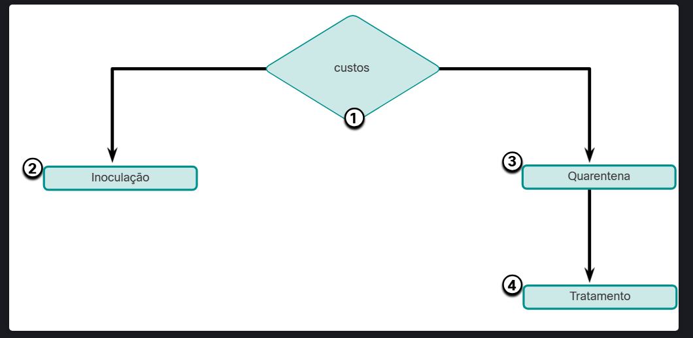

# 4.3.1 Defender a Rede
Vigilância constante e educação contínua são necessários para defender sua rede contra ataques. Veja a seguir as melhores práticas para proteger uma rede:

- Desenvolva uma política de segurança escrita para a empresa.
- Eduque os funcionários sobre os riscos de engenharia social e desenvolva estratégias para validar identidades por telefone, por e-mail ou pessoalmente.
- Controle o acesso físico aos sistemas.
- Use senhas fortes e altere-as com frequência.
- Criptografar e proteger por senha dados sensíveis.
- Implemente hardware e software de segurança, como firewalls, IPSs, dispositivos de rede privada virtual (VPN), software antivírus e filtragem de conteúdo.
- Realize backups e teste os arquivos de backup regularmente.
- Desligue os serviços e portas desnecessários.
- Mantenha as correções atualizadas, instalando-as semanais ou diariamente, se possível, para evitar ataques de escalonamento de transbordamento e privilégio.
- Execute auditorias de segurança para testar a rede.

# 4.3.2 Mitigando Malware
Malware, incluindo vírus, worms e cavalos de Tróia, pode causar sérios problemas em redes e dispositivos finais. Os administradores de rede têm vários meios de mitigar esses ataques.

Nota: As técnicas de mitigação são frequentemente referidas na comunidade de segurança como “contramedidas”.

Uma maneira de mitigar ataques de vírus e cavalos de Tróia é o software antivírus. O software antivírus ajuda a impedir que os hosts sejam infectados e espalhem código malicioso. Isso requer muito mais tempo para limpar computadores infectados do que para manter atualizações de software antivírus e definições de antivírus nas mesmas máquinas.

O software antivírus é o produto de segurança mais amplamente implantado no mercado hoje. Várias empresas que criam software antivírus, como Symantec, McAfee e Trend Micro, estão no negócio de detectar e eliminar vírus há mais de uma década. Muitas corporações e instituições educacionais compram licenciamento por volume para seus usuários. Os usuários são capazes de fazer login em um site com sua conta e baixar o software antivírus em seus desktops, laptops ou servidores.

Os produtos antivírus têm opções de automação de atualização para que novas definições de vírus e novas atualizações de software possam ser baixadas automaticamente ou sob demanda. Esta prática é o requisito mais crítico para manter uma rede livre de vírus e deve ser formalizada em uma política de segurança de rede.

Os produtos antivírus são baseados em host. Esses produtos são instalados em computadores e servidores para detectar e eliminar vírus. No entanto, eles não impedem que vírus entrem na rede, portanto, um profissional de segurança de rede deve estar ciente dos principais vírus e acompanhar as atualizações de segurança em relação a vírus emergentes.

Outra maneira de mitigar ameaças de malware é evitar que arquivos de malware entrem na rede. Dispositivos de segurança no perímetro da rede podem identificar arquivos de malware conhecidos com base em seus indicadores de compromisso. Os arquivos podem ser removidos do fluxo de dados de entrada antes que eles possam causar um incidente. Infelizmente, os atores da ameaça estão cientes dessa contramedida e frequentemente alteram seu malware o suficiente para evitar a detecção. Essas façanhas entrarão na rede e também evitarão software antivírus. Nenhuma técnica de mitigação pode ser 100% eficaz. Incidentes de segurança vão acontecer.

# 4.3.3 Mitigando Worms
Worms são mais baseados em rede do que vírus. A mitigação de worm requer diligência e coordenação por parte dos profissionais de segurança de rede.

Como mostrado na figura, a resposta a um ataque de vermes pode ser dividida em quatro fases: contenção, inoculação, quarentena e tratamento.

## Contenção
A fase de contenção envolve limitar a propagação de uma infecção por vermes para áreas da rede que já estão afetadas. Isso requer compartimentação e segmentação da rede para abrandar ou parar o worm e evitar que hosts atualmente infectados segmentem e infectem outros sistemas. A contenção requer o uso de ACLs de saída e entrada em roteadores e firewalls em pontos de controle dentro da rede.

## Inoculação
A fase de inoculação corre paralela ou subsequente à fase de contenção. Durante a fase de inoculação, todos os sistemas não infectados são corrigidos com o patch de fornecedor apropriado. O processo de inoculação priva ainda mais o worm de quaisquer alvos disponíveis.

## Quarentena
A fase de quarentena envolve rastrear e identificar máquinas infectadas dentro das áreas contidas e desconectá-las, bloquear ou removê-las. Isto isola estes sistemas adequadamente para a fase de tratamento.

## Tratamento
A fase de tratamento envolve a desinfecção ativa dos sistemas infectados. Isso pode envolver encerrar o processo do worm, remover arquivos modificados ou configurações do sistema introduzidos pelo worm e corrigir a vulnerabilidade que o worm usou para explorar o sistema. Alternativamente, em casos mais graves, o sistema pode precisar ser reinstalado para garantir que o worm e seus subprodutos sejam removidos.

# 4.3.4 Mitigando Ataques de Reconhecimento

## Técnicas de mitigação de ataque de reconhecimento

Os ataques de reconhecimento são tipicamente o precursor de outros ataques que têm a intenção de obter acesso não autorizado a uma rede ou interromper a funcionalidade da rede. Um profissional de segurança de rede pode detectar quando um ataque de reconhecimento está em andamento recebendo notificações de alarmes pré-configurados. Estes alarmes são provocados quando determinados parâmetros são excedidos, tal como o número de pedidos ICMP por segundo. Uma variedade de tecnologias e dispositivos podem ser usados para monitorar esse tipo de atividade e gerar um alarme. A ferramenta de segurança adaptável (ASA) de Cisco fornece a prevenção da intrusão em um dispositivo autônomo. Além disso, os roteadores corporativos, como os Cisco Integrated Services Routers (ISR), oferecem suporte à prevenção contra invasões na rede com software adicional.

Os ataques de reconhecimento podem ser mitigados de várias maneiras, incluindo o seguinte:

Autenticação de implementação para garantir o acesso adequado.
Usando a criptografia para renderizar os ataques do Sniffer do pacote.
Usando ferramentas anti-sniffer para detectar ataques de sniffer de pacotes.
Implementando uma infraestrutura comutada.
Usando um firewall e IPS.
O software anti-sniffer e as ferramentas de hardware detectam mudanças no tempo de resposta dos hosts para determinar se os hosts estão processando mais tráfego do que suas próprias cargas de tráfego indicariam. Embora isso não elimine completamente a ameaça, como parte de um sistema geral de mitigação, pode reduzir o número de instâncias de ameaça.

A criptografia também é eficaz para mitigar ataques de sniffer de pacotes. Se o tráfego é criptografado, usar um sniffer de pacote é de pouca utilidade porque os dados capturados não são legíveis.

É impossível mitigar a varredura de portas, mas usar um sistema de prevenção de intrusões (IPS) e firewall pode limitar as informações que podem ser descobertas com um scanner de porta. As varreduras de ping podem ser paradas se o eco ICMP e a resposta de eco estiverem desligados nos roteadores de borda; contudo, quando esses serviços são desligados, os dados de diagnóstico de rede são perdidos. Além disso, as varreduras de porta podem ser executadas sem varreduras de ping completas. As varreduras simplesmente levam mais tempo porque os endereços IP inativos também são verificados.

# 4.3.5 Mitigando ataques de acesso
Várias técnicas estão disponíveis para mitigar ataques de acesso. Estes incluem segurança de senha forte, princípio de confiança mínima, criptografia, aplicação de patches de sistema operacional e aplicativos.

Um número surpreendente de ataques de acesso é realizado através de simples adivinhação de senha ou ataques de dicionário de força bruta contra senhas. Para se defender contra isso, crie e imponha uma política de autenticação forte que inclua:

Usar senhas fortes - Senhas fortes são pelo menos oito caracteres e contêm letras maiúsculas, letras minúsculas, números e caracteres especiais.
Desativar contas após um número especificado de logins malsucedidos ter ocorrido - Esta prática ajuda a evitar tentativas contínuas de senha.
A rede também deve ser projetada usando o princípio da confiança mínima. Isso significa que os sistemas não devem usar um ao outro desnecessariamente. Por exemplo, se uma organização tiver um servidor confiável usado por dispositivos não confiáveis, como servidores Web, o servidor confiável não deve confiar nos dispositivos não confiáveis incondicionalmente.

A criptografia é um componente crítico de qualquer rede segura moderna. Recomenda-se o uso de criptografia para acesso remoto a uma rede. O tráfego do protocolo de roteamento também deve ser criptografado. Quanto mais o tráfego for criptografado, menos oportunidades que os hackers têm para interceptar dados com ataques man-in-the-middle.

O uso de protocolos de autenticação criptografados ou hash, juntamente com uma política de senha forte, reduz consideravelmente a probabilidade de ataques de acesso bem-sucedidos.

Por fim, eduque os funcionários sobre os riscos da engenharia social e desenvolva estratégias para validar identidades por telefone, e-mail ou pessoalmente. A autenticação multifator (MFA) tornou-se cada vez mais comum. Nesta abordagem, a autenticação requer dois ou mais meios independentes de verificação. Por exemplo, uma senha pode ser combinada com um código que é enviado por uma mensagem de texto. Software ou dispositivos separados podem ser usados para gerar tokens que são bons para apenas um uso. Esses valores de token, quando fornecidos com uma senha, fornecem uma camada adicional de segurança que impede o uso de senhas que foram adivinhadas ou roubadas por atores de ameaça.

Em geral, os ataques de acesso podem ser detectados através da revisão de logs, utilização da largura de banda e cargas de processo. A política de segurança de rede deve especificar que os logs são formalmente mantidos para todos os dispositivos e servidores de rede. Ao revisar os logs, o pessoal de segurança da rede pode determinar se ocorreu um número incomum de tentativas de login com falha.

# 4.3.6 Mitigação de Ataques DoS

Um dos primeiros sinais de um ataque DoS é um grande número de reclamações de usuários sobre recursos indisponíveis ou desempenho de rede excepcionalmente lento. Para minimizar o número de ataques, um pacote de software de utilização de rede deve estar sempre em execução. A análise do comportamento da rede pode detectar padrões incomuns de uso que indicam que um ataque DoS está ocorrendo. Um meio de detectar um comportamento incomum de rede deve ser exigido pela política de segurança de rede da organização. Um gráfico de utilização de rede mostrando atividade incomum também pode indicar um ataque DoS.

Os ataques DoS podem ser um componente de uma ofensiva maior. Os ataques DoS podem levar a problemas nos segmentos de rede dos computadores que estão sendo atacados. Por exemplo, a capacidade de pacote por segundo de um roteador entre a Internet e uma LAN pode ser excedida por um ataque, comprometendo não somente o sistema de destino, mas também os dispositivos de rede pelos quais o tráfego deve passar. Se o ataque for realizado em escala suficientemente grande, regiões geográficas inteiras de conectividade com a Internet podem ser comprometidas.

Historicamente, muitos ataques DoS foram provenientes de endereços falsificado. Os roteadores e switches Cisco apoiam um número de tecnologias antispoofing, tais como a segurança da porta, a espionagem do protocolo de configuração dinâmica do host (DHCP), o protetor da fonte IP, a inspeção do protocolo de resolução de endereço dinâmico (DAI), e as listas de controle de acesso (ACLs).