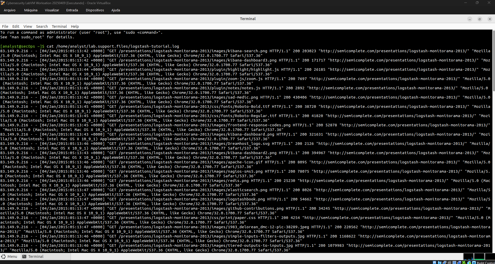
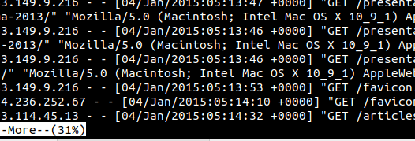
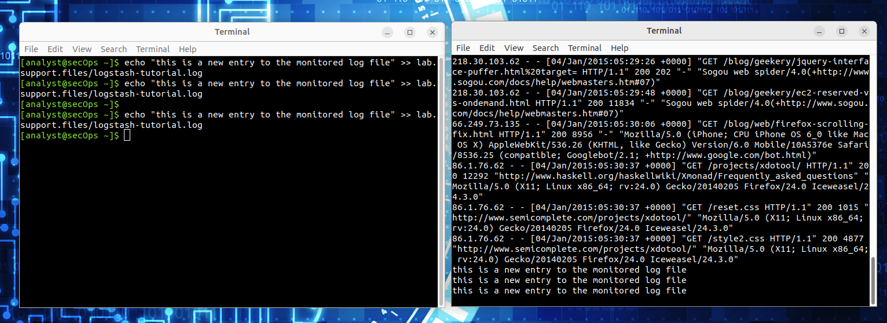
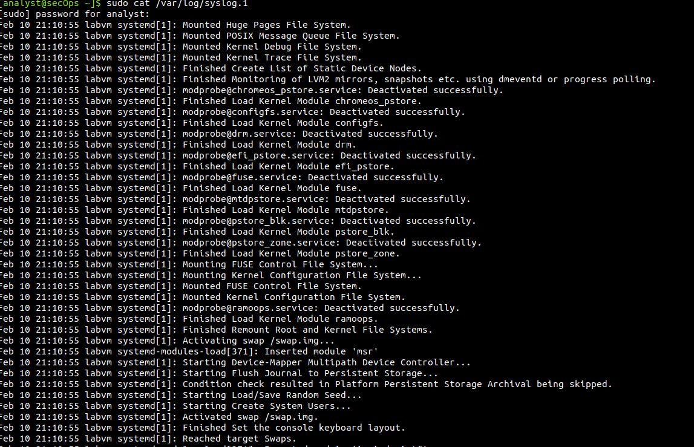

Este lab se concentra em quatro programas baseados em linha de comando: cat,more, less, e tail.

O início do arquivo pode se perder, pois o cat não oferece suporte para quebra de página.

Outra ferramenta popular para visualizar arquivos de log é more. Igual a cat,more também é uma ferramenta baseada em linha de comando UNIX que pode abrir um arquivo baseado em texto e exibir o conteúdo do arquivo na tela. A principal diferença entre cat e more é que more suporta quebras de página, permitindo que o usuário visualize o conteúdo de um arquivo, uma página por vez. Isso pode ser feito usando a barra de espaço para exibir a próxima página.

Com base na funcionalidade de cat e more, a ferramenta less permite que o conteúdo de um arquivo seja exibido página por página, ao mesmo tempo que permite ao usuário a opção de visualizar as páginas exibidas anteriormente.

comando tail exibe o fim de um arquivo de texto. Por padrão, o tail exibe as últimas dez linhas do arquivo.

tail -f para monitorar ativamente o conteúdo do arquivo /var/log/syslog:

O Syslog é uma solução padrão para registro em log. Ele usa arquivos de texto simples, mas não tem estrutura. As informações não são centralizadas, e pode ser necessário pesquisar muitas informações não relacionadas para encontrar informações relevantes. O Syslog não fornece uma maneira de separar as mensagens pelos aplicativos relacionados. Além disso, os arquivos de texto simples podem exigir rotação para evitar que se tornem muito grandes. O Journald substituiu os arquivos de log de texto simples por um formato de arquivo especial para mensagens de log. Isso torna mais fácil encontrar mensagens de log relevantes.

