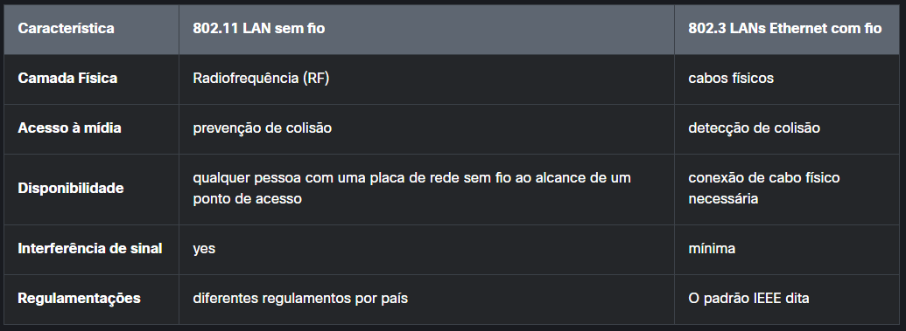
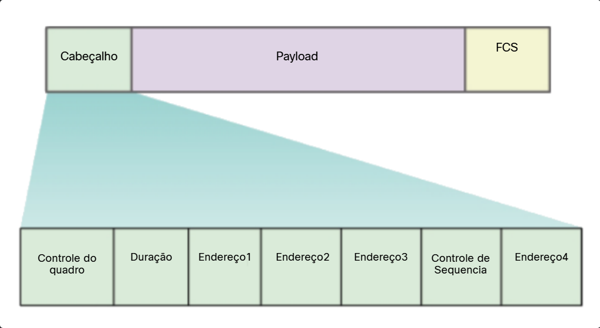

# 5.1.2 LANs Wireless versus LANs Wired

As WLANs usam Freqüências de Rádio (RF) em vez de cabos na camada física e na subcamada MAC da camada de enlace de dados. As WLANs compartilham uma origem semelhante com as LANs Ethernet. O IEEE adotou o portfólio 802 LAN/MAN de padrões de arquitetura de rede de computadores. Os dois grupos de trabalho dominantes 802 são 802.3 Ethernet, que definiu Ethernet para LANs com fio, e 802.11 que definiu Ethernet para WLANs. Existem diferenças importantes entre os dois.

As WLANs também diferem das LANs com fio da seguinte forma: 

As WLANs conectam clientes à rede por meio de um ponto de acesso sem fio (AP) ou roteador sem fio, em vez de um switch Ethernet.
As WLANs conectam dispositivos móveis que geralmente são alimentados por bateria, em vez de dispositivos LAN conectados. As placas de rede sem fio tendem a reduzir a duração da bateria de um dispositivo móvel.
WLANs suportam hosts que disputam acesso na mídia de RF (bandas de frequência). O 802.11 prescreve a prevenção de colisões (CSMA/CA) em vez de detecção de colisões (CSMA/CD) para acesso à mídia para evitar colisões proativamente dentro da mídia.
As WLANs usam um formato de quadro diferente das LANs Ethernet com fio. As WLANs exigem informações adicionais no cabeçalho da Camada 2 do quadro.
As WLANs levantam mais problemas de privacidade porque as frequências de rádio podem chegar fora das instalações.

#  5.1.3 Estrutura do Quadro 802.11

Lembre-se de que todos os quadros da camada 2 consistem em uma seção de cabeçalho, carga útil e sequência de verificação de quadro (FCS - Frame Check Sequence). O formato de quadro 802.11 é semelhante ao formato de quadro Ethernet, exceto pelo fato de conter mais campos, conforme mostrado na figura.

Todos os quadros sem fio 802.11 contêm os seguintes campos:

Controle de quadro - Identifica o tipo de quadro sem fio e contém subcampos para versão do protocolo, tipo de quadro, tipo de endereço, gerenciamento de energia e configurações de segurança.
Duração - Isso normalmente é usado para indicar a duração restante necessária para receber a próxima transmissão de quadro.
Address1 - Geralmente contém o endereço MAC do dispositivo sem fio ou AP receptor.
Address2 - Geralmente contém o endereço MAC do dispositivo sem fio ou AP de transmissão.
Address3 - Isso às vezes contém o endereço MAC do destino, como a interface do roteador (gateway padrão) ao qual o AP está conectado.
Sequence Control - Contém informações para controlar o sequenciamento e os quadros fragmentados.
Address4 - Isso geralmente está ausente porque é usado apenas no modo ad hoc.
Payload - Contém os dados para transmissão.
FCS - Isso é usado para controle de erro da camada 2.

#  5.1.4 CSMA/CA

As WLANs são configurações de mídia compartilhada half-duplex. Half-duplex significa que apenas um cliente pode transmitir ou receber a qualquer momento. Mídia compartilhada significa que todos os clientes sem fio podem transmitir e receber no mesmo canal de rádio. Isso cria um problema porque um cliente sem fio não pode ouvir enquanto está enviando, o que torna impossível detectar uma colisão.

Para resolver esse problema, as WLANs usam o acesso múltiplo com detecção de operadora com prevenção de colisão (CSMA / CA) como o método para determinar como e quando enviar dados na rede. Um cliente sem fio faz o seguinte:

1. Ouve o canal para ver se ele está ocioso, o que significa que nenhum outro tráfego está atualmente no canal. O canal também é chamado de portadora.
2. Envia uma mensagem pronta para enviar (RTS) para o ponto de acesso para solicitar acesso dedicado à rede.
3. Recebe uma mensagem clara para enviar (CTS) do ponto de acesso que concede acesso ao envio.
4. Se o cliente sem fio não receber uma mensagem CTS, ele aguardará um período aleatório antes de reiniciar o processo.
5. Depois de receber o CTS, ele transmite os dados.
6. Todas as transmissões são confirmadas. Se um cliente sem fio não receber uma confirmação, ele assume uma colisão e reinicia o processo.

