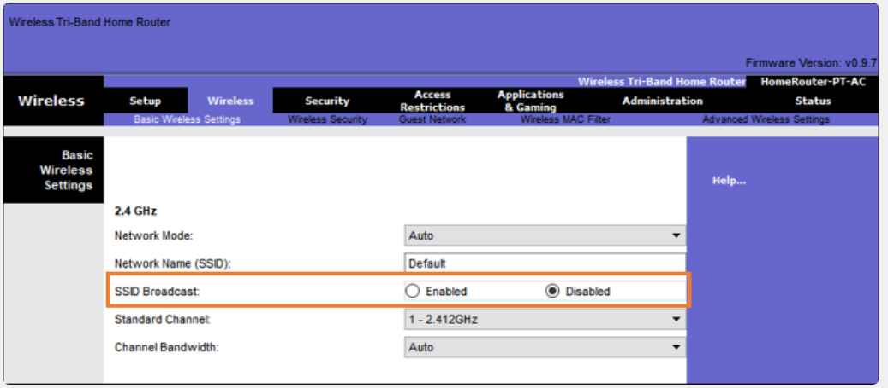
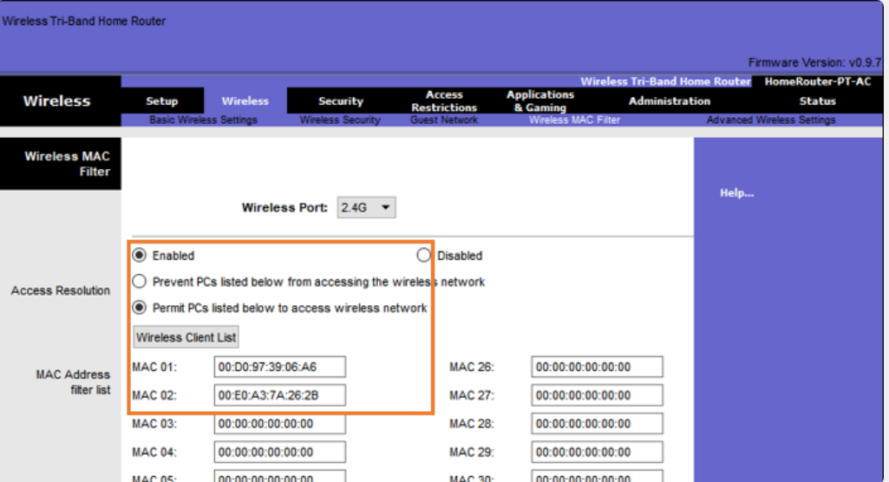
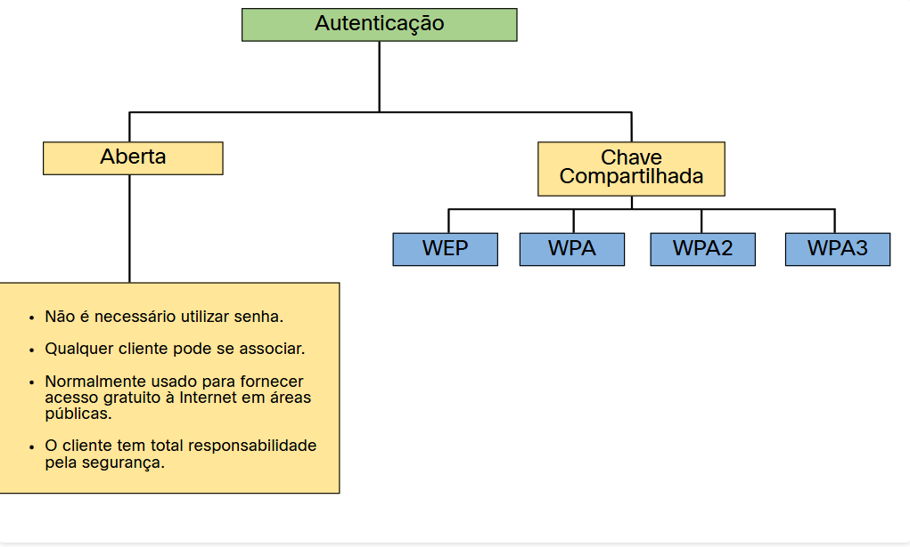
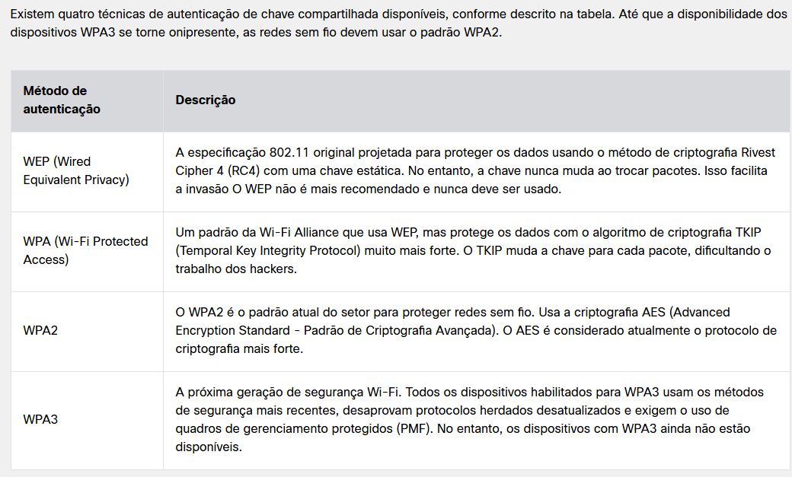
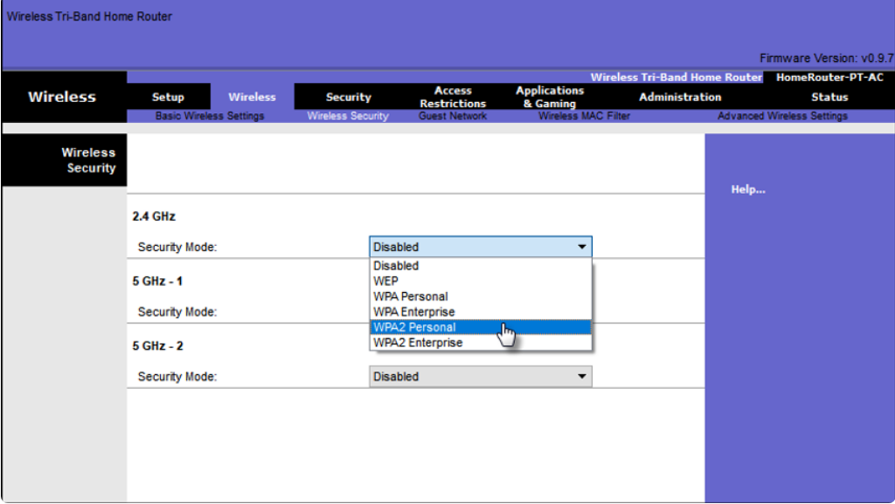
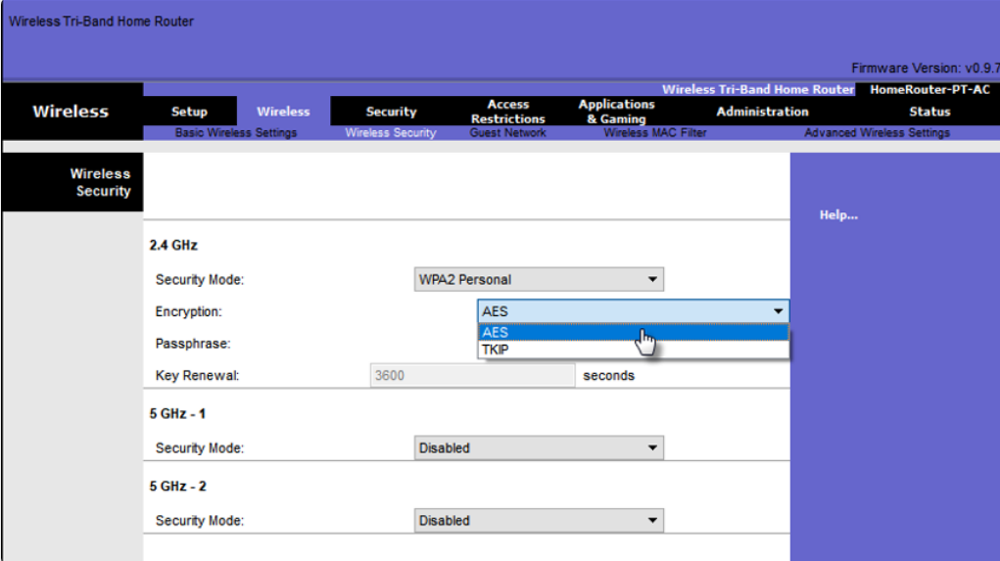
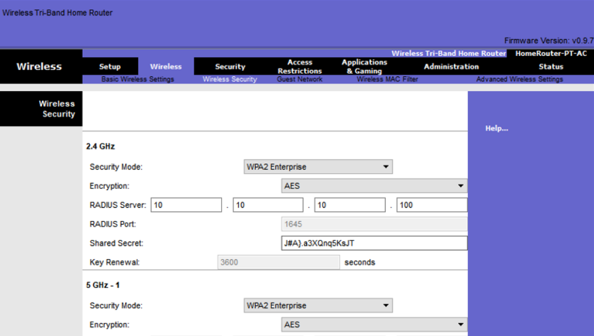

#  5.3.2 SSID Cloaking e Filtragem de Endereço MAC

Os sinais sem fio podem viajar através de materiais sólidos, como tetos, pisos, paredes, fora de casa ou escritórios. Sem medidas rigorosas de segurança, a instalação de uma WLAN pode ser equivalente a colocar portas Ethernet em qualquer lugar, mesmo fora do escritorio ou casa.

Para lidar com as ameaças de impedir invasores sem fio e proteger dados, dois recursos de segurança anteriores foram usados e ainda estão disponíveis na maioria dos roteadores e pontos de acesso: camuflagem SSID e filtragem de endereço MAC.

Ocultação do SSID

Os pontos de acesso e alguns roteadores sem fio permitem que o quadro de sinalização SSID seja desativado, conforme mostrado na figura. Os clientes sem fio devem configurar manualmente o SSID para se conectar à rede.

Filtragem de endereços MAC

Um administrador pode permitir ou negar manualmente o acesso sem fio dos clientes com base em seu endereço físico de hardware MAC. Na figura, o roteador está configurado para permitir dois endereços MAC. Dispositivos com endereços MAC diferentes não poderão ingressar na WLAN de 2,4 GHz.

#  5.3.3 Métodos de autenticação originais 802.11

Embora esses dois recursos dissuadam a maioria dos usuários, a realidade é que nem a ocultação do SSID nem a filtragem de endereços MAC impediriam um intruso astuto. Os SSIDs são facilmente descobertos, mesmo que os pontos de acesso não os transmitam e os endereços MAC podem ser falsificados. A melhor maneira de proteger uma rede sem fio é usar sistemas de autenticação e criptografia.

Dois tipos de autenticação foram introduzidos com o padrão 802.11 original:

Autenticação de sistema aberto - Qualquer cliente sem fio deve ser facilmente capaz de se conectar e deve ser usado apenas em situações em que a segurança não é uma preocupação, como aquelas que fornecem acesso gratuito à Internet, como cafés, hotéis e áreas remotas. O cliente sem fio é responsável por fornecer segurança, como usar uma rede virtual privada (VPN) para conectar-se com segurança. As VPNs fornecem serviços de autenticação e criptografia. As VPNs estão além do escopo deste tópico.
Autenticação de chave compartilhada - Fornece mecanismos, como WEP, WPA, WPA2 e WPA3 para autenticar e criptografar dados entre um cliente sem fio e o AP. No entanto, a senha deve ser pré-compartilhada entre as duas partes para se conectar.
O gráfico a seguir resume esses métodos de autenticação.

# 5.3.4 Métodos de Autenticação de Chave Compartilhada

# 5.3.5 Autenticação de um usuário doméstico

Os roteadores domésticos geralmente têm duas opções para autenticação: WPA e WPA2. WPA2 é o mais forte dos dois. A figura mostra a opção para selecionar um dos dois métodos de autenticação WPA2:

- Pessoal - Destinado a redes domésticas ou de pequenos escritórios, os usuários se autenticam usando uma chave pré-compartilhada (PSK). Os clientes sem fio se autenticam com o roteador sem fio usando uma senha pré-compartilhada. Nenhum servidor de autenticação especial é necessário.
- Enterprise - Destinado a redes corporativas, mas requer um servidor de autenticação RADIUS (Remote Authentication Dial-In User Service). Embora seja mais complicado de configurar, ele fornece segurança adicional. O dispositivo deve ser autenticado pelo servidor RADIUS e os usuários devem se autenticar usando o padrão 802.1X, que usa o EAP (Extensible Authentication Protocol) para autenticação.

Na figura, o administrador está configurando o roteador sem fio com autenticação pessoal WPA2 na faixa de 2,4 GHz.

# 5.3.6 Métodos de Criptografia

Criptografia é usada para proteger os dados. Se um invasor capturar dados criptografados, não poderá decifrá-los em um período de tempo razoável.

Os padrões WPA e WPA2 usam os seguintes protocolos de criptografia:

- Temporal Key Integrity Protocol (TKIP) - TKIP é o método de criptografia usado pelo WPA. Ele fornece suporte para equipamentos WLAN herdados, abordando as falhas originais associadas ao método de criptografia 802.11 WEP. Ele usa o WEP, mas criptografa a carga útil da camada 2 usando o TKIP e executa um MIC (Message Integrity Check) no pacote criptografado para garantir que a mensagem não seja alterada.
- Advanced Encryption Standard (AES) - AES é o método de criptografia usado pelo WPA2. É o método preferido porque é um método muito mais forte de criptografia. Ele usa o Modo de Cifra de Contador com o Protocolo de Código de Autenticação de Mensagem em Cadeia de Blocos (CCMP - Chaining Message Authentication Code Protocol) que permite que os hosts de destino reconheçam se os bits criptografados e não criptografados foram alterados.

Na figura, o administrador está configurando o roteador sem fio para usar WPA2 com criptografia AES na faixa de 2,4 GHz.

#  5.3.7 Autenticação na Empresa

Em redes com requisitos de segurança mais rígidos, é necessária uma autenticação ou login adicional para conceder acesso a clientes sem fio. A opção do modo de segurança corporativa requer um servidor RADIUS de autenticação, autorização e contabilidade (AAA - Authentication, Authorization, and Accounting).

- Endereço IP do servidor RADIUS - Este é o endereço acessível do servidor RADIUS.
- Números de porta UDP - Portas UDP oficialmente atribuídas 1812 para autenticação RADIUS e 1813 para contabilidade RADIUS, mas também podem operar usando as portas UDP 1645 e 1646, conforme mostrado na figura.
- Chave compartilhada - Usada para autenticar o AP com o servidor RADIUS.

Na figura, o administrador está configurando o roteador sem fio com autenticação WPA2 Enterprise usando criptografia AES. O endereço IPv4 do servidor RADIUS também é configurado com uma senha forte para ser usada entre o roteador sem fio e o servidor RADIUS.

A chave compartilhada não é um parâmetro que deve ser configurado em um cliente sem fio. É necessário apenas no ponto de acesso para se autenticar com o servidor RADIUS. A autenticação e autorização do usuário são tratadas pelo padrão 802.1X, que fornece uma autenticação centralizada e baseada em servidor dos usuários finais.

O processo de login 802.1X usa o EAP para se comunicar com o servidor AP e RADIUS. O EAP é uma estrutura para autenticar o acesso à rede. Ele pode fornecer um mecanismo de autenticação segura e negociar uma chave privada segura que pode ser usada para uma sessão de criptografia sem fio usando a criptografia TKIP ou AES.

# 5.3.8 WPA3

## WPA3-Personal (Pessoal)

No WPA2-Personal, os atores de ameaças podem ouvir o “aperto de mão” (handshake) entre um cliente sem fio e o AP e usar um ataque de força bruta para tentar adivinhar o PSK. O WPA3-Personal impede esse ataque usando a autenticação simultânea de iguais (SAE), um recurso especificado no IEEE 802.11-2016. O PSK nunca é exposto, tornando impossível para o atacante adivinhar.

## WPA3-Enterprise (Corporativo)

O WPA3-Enterprise ainda usa autenticação 802.1X / EAP. No entanto, requer o uso de um conjunto criptográfico de 192 bits e elimina a mistura de protocolos de segurança para os padrões 802.11 anteriores. O WPA3-Enterprise adere ao conjunto comercial de algoritmos de segurança nacional (CNSA - Commercial National Security Algorithm), que é comumente usado em redes Wi-Fi de alta segurança.

## Redes abertas

As redes abertas no WPA2 enviam o tráfego do usuário em texto não autenticado e limpo. No WPA3, as redes Wi-Fi abertas ou públicas ainda não usam autenticação. No entanto, eles usam o OWE (Opportunistic Wireless Encryption) para criptografar todo o tráfego sem fio.

## Integração da IoT

Embora o WPA2 tenha incluído o Wi-Fi Protected Setup (WPS) para dispositivos embarcados rapidamente, sem configurá-los primeiro, o WPS é vulnerável a uma variedade de ataques e não é recomendado. Além disso, os dispositivos de IoT são tipicamente decapitados, o que significa que eles não têm GUI incorporada para configuração e precisavam de qualquer maneira fácil de se conectar à rede sem fio. O Protocolo de provisionamento de dispositivo (DPP - Device Provisioning Protocol) foi projetado para atender a essa necessidade. Cada dispositivo projetado para operar sem tela, teclado e mouse possui uma chave pública codificada diretamente no seu firmware ou hardware. A chave é tipicamente impressa na parte externa do dispositivo ou em sua embalagem como um código de resposta rápida (QR Code). O administrador da rede pode digitalizar o código QR e integrar rapidamente o dispositivo. Embora não faça parte estritamente do padrão WPA3, o DPP substituirá o WPS ao longo do tempo.