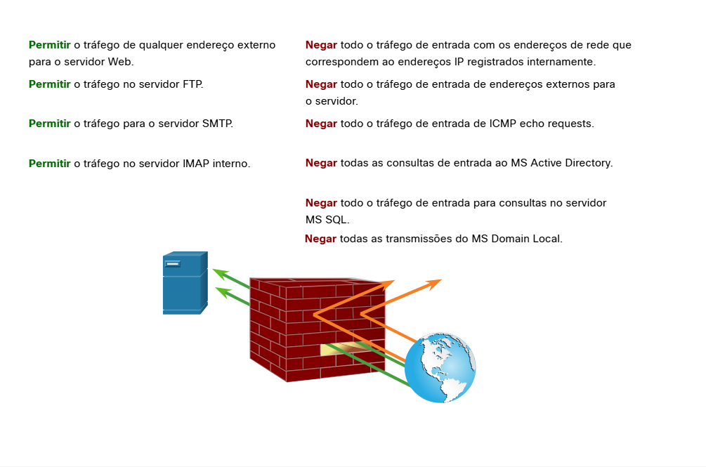
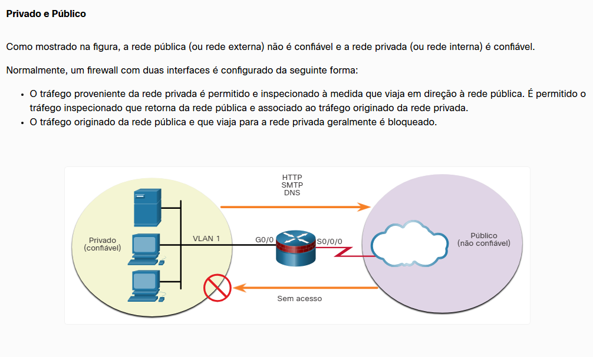
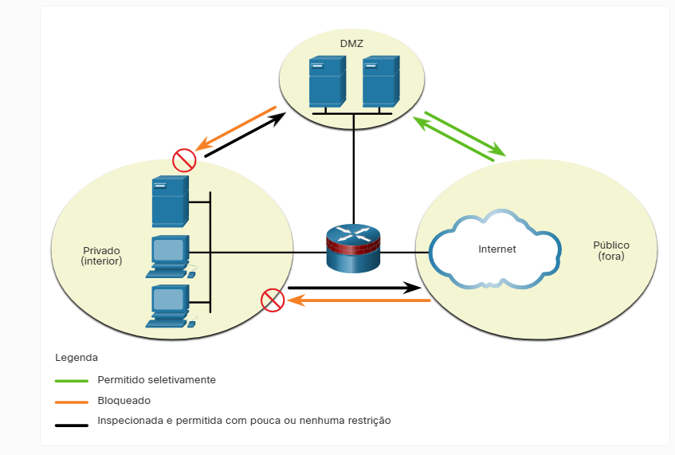
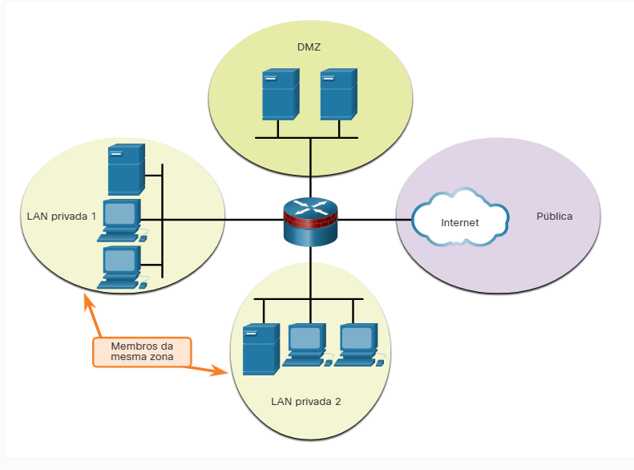
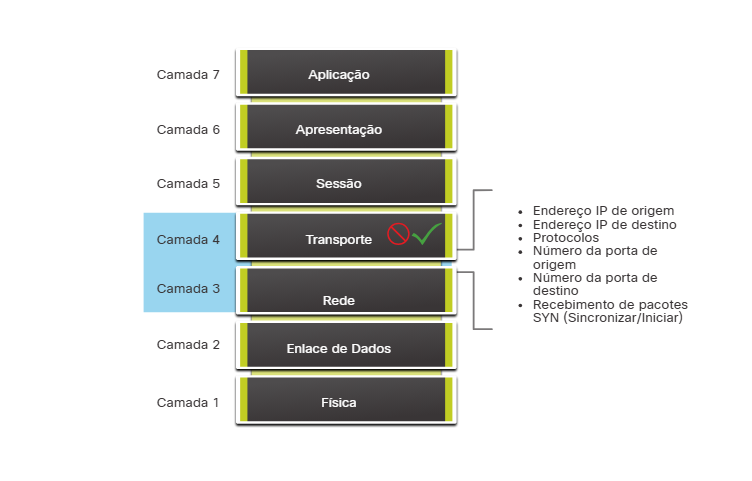
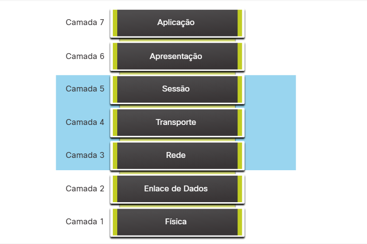
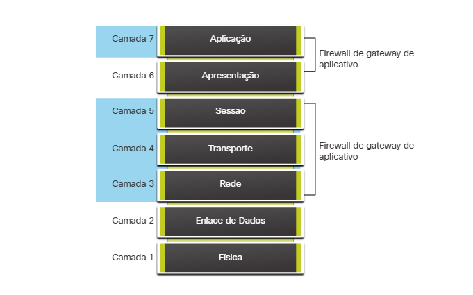
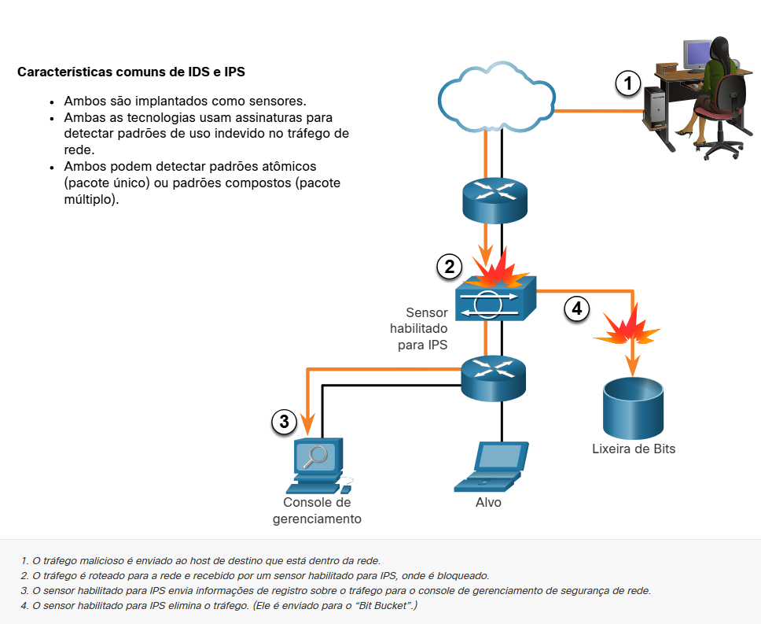
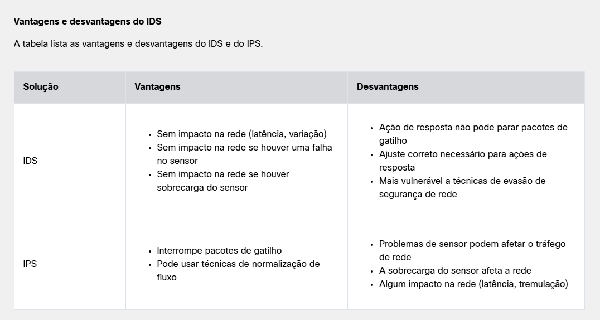
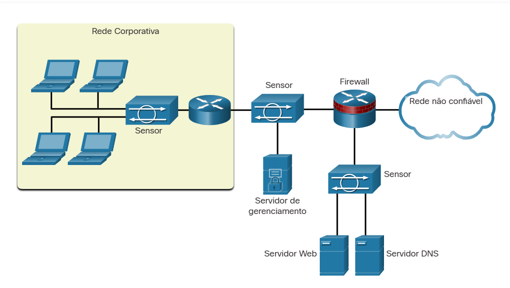

#  6.1.2 Firewalls

Um firewall é um sistema ou grupo de sistemas que aplica uma política de controle de acesso entre redes.

## Propriedades comuns do Firewall
Todos os firewalls compartilham algumas propriedades comuns:

- Os firewalls são resistentes a ataques de rede.
- Firewalls são o único ponto de trânsito entre redes corporativas internas e redes externas porque todo o tráfego flui através do firewall.
- Firewalls reforçam a política de controle de acesso.

## Benefícios do firewall
Existem vários benefícios do uso de um firewall em uma rede:

- Eles impedem a exposição de hosts, recursos e aplicações sensíveis a usuários não confiáveis.
- Eles sanitizam o fluxo do protocolo, o que impede a exploração de falhas no protocolo.
- Eles bloqueiam dados maliciosos de servidores e clientes.
- Eles reduzem a complexidade do gerenciamento de segurança descarregando a maior parte do controle de acesso à rede para alguns firewalls na rede.

## Limitações do Firewall
Os firewalls também têm algumas limitações:

- Um firewall mal configurado pode ter sérias conseqüências para a rede, como se tornar um único ponto de falha.
- Os dados de muitos aplicativos não podem ser transmitidos por firewalls com segurança.
- Os usuários podem procurar proativamente maneiras de contornar o firewall para receber material bloqueado, o que expõe a rede a possíveis ataques.
- O desempenho da rede pode diminuir.
- O tráfego não autorizado pode ser encapsulado ou escondido como tráfego legítimo através do firewall.

# 6.1.3 Arquiteturas comuns de segurança

O design do firewall é principalmente sobre interfaces de dispositivo que permitem ou negam tráfego com base na origem, no destino e no tipo de tráfego. Alguns designs são tão simples quanto designar uma rede externa e uma rede interna, que são determinados por duas interfaces em um firewall.

Zona Desmilitarizada
Uma zona desmilitarizada (DMZ) é um projeto de firewall onde normalmente há uma interface interna conectada à rede privada, uma interface externa conectada à rede pública e uma interface DMZ, conforme mostrado na figura.

O tráfego proveniente da rede privada é inspecionado à medida que ele viaja para a rede pública ou DMZ. Este tráfego é permitido com pouca ou nenhuma restrição. Tráfego inspecionado que retorna da DMZ ou da rede pública para a rede privada é permitido.
O tráfego originado da rede DMZ e que viaja para a rede privada geralmente é bloqueado.
O tráfego originado da rede DMZ e viajando para a rede pública é permitido seletivamente com base nos requisitos de serviço.
O tráfego proveniente da rede pública e que viaja em direção à DMZ é seletivamente permitido e inspecionado. Esse tipo de tráfego normalmente é tráfego de email, DNS, HTTP ou HTTPS. O tráfego de retorno da DMZ para a rede pública é permitido dinamicamente.
O tráfego originado da rede pública e que viaja para a rede privada está bloqueado.

Firewalls de política baseados em zona
Os firewalls de política baseados em zona (ZPFs) usam o conceito de zonas para fornecer flexibilidade adicional. Uma zona é um grupo de uma ou mais interfaces que têm funções ou recursos semelhantes. As zonas ajudam a especificar onde uma regra ou política de firewall do Cisco IOS deve ser aplicada. Na figura, as políticas de segurança para LAN 1 e LAN 2 são semelhantes e podem ser agrupadas em uma zona para configurações de firewall. Por padrão, o tráfego entre interfaces na mesma zona não está sujeito a nenhuma política e passa livremente. No entanto, todo o tráfego de zona para zona está bloqueado. Para permitir o tráfego entre as zonas, uma política que permite ou inspeciona o tráfego deve ser configurada.

A única exceção a este padrão deny any política é a zona própria do roteador. A zona auto é o próprio roteador e inclui todos os endereços IP da interface do roteador. As configurações de política que incluem a zona automática aplicar-se-iam ao tráfego destinado e proveniente do roteador. Por padrão, não há nenhuma política para esse tipo de tráfego. O tráfego que deve ser considerado ao projetar uma política para a auto zona inclui o tráfego de plano de gerenciamento e plano de controle, como SSH, SNMP e protocolos de roteamento.

# 6.1.4 Descrições de tipos de firewall

É importante entender os diferentes tipos de firewalls e suas capacidades específicas para que o firewall correto seja usado para cada situação.

## Firewall de filtragem de pacotes (sem estado)

Os firewalls de filtragem de pacotes geralmente fazem parte de um firewall de roteador, que permite ou nega tráfego com base nas informações da Camada 3 e da Camada 4. Eles são firewalls sem estado que usam uma simples pesquisa de tabela de políticas que filtra o tráfego com base em critérios específicos.

Por exemplo, os servidores SMTP escutam a porta 25 por padrão. Um administrador pode configurar o firewall de filtragem de pacotes para bloquear a porta 25 de uma estação de trabalho específica para impedir que ele transmita um vírus de e-mail

## Firewall com monitoração de estado

Firewalls com estado são as tecnologias de firewall mais versáteis e mais comuns em uso. Os firewalls stateful fornecem filtragem de pacotes stateful usando informações de conexão mantidas em uma tabela de estado. Filtragem com estado é uma arquitetura de firewall classificada na camada de rede. Ele também analisa o tráfego na camada 4 da OSI e na camada 5.

## Firewall de gateway de aplicativo

Um firewall de gateway de aplicação (firewall proxy), conforme mostrado na figura, filtra as informações nas camadas 3, 4, 5 e 7 do modelo de referência OSI. A maior parte do controle e filtragem do firewall é feita em software. Quando um cliente precisa acessar um servidor remoto, ele se conecta a um servidor proxy. O servidor proxy se conecta ao servidor remoto em nome do cliente. Portanto, o servidor só vê uma conexão do servidor proxy.

# Firewalls de próxima geração
Os firewalls de última geração (NGFW) vão além dos firewalls de estado, fornecendo:

Prevenção de intrusão integrada
Reconhecimento e controle de aplicativos para ver e bloquear aplicativos arriscados
Caminhos de atualização para incluir futuros feeds de informações
Técnicas para lidar com ameaças de segurança em evolução

Outros métodos de implementação de firewalls incluem:

Firewalls baseados em host é - Um PC ou servidor com software de firewall em execução nele.
Firewall transparente - Filtra o tráfego IP entre um par de interfaces em ponte.
Firewall híbrido - Uma combinação dos vários tipos de firewall. Por exemplo, um firewall de inspeção de aplicações combina um firewall com estado com um firewall de gateway de aplicativo.

# 6.1.6 Dispositivos de prevenção e detecção de intrusão

Características de IDS e IPS
Uma mudança de paradigma de arquitetura de rede é necessária para se defender contra ataques rápidos e em evolução. Isso deve incluir sistemas de prevenção e detecção de baixo custo, como sistemas de detecção de intrusão (IDS) ou os sistemas de prevenção de intrusão mais escalonáveis (IPS). A arquitetura de rede integra essas soluções nos pontos de entrada e saída da rede.

Ao implementar IDS ou IPS, é importante estar familiarizado com os tipos de sistemas disponíveis, abordagens baseadas em host e em rede, o posicionamento desses sistemas, a função das categorias de assinatura e possíveis ações que um roteador Cisco IOS pode executar quando um ataque é detectado.

A figura mostra como um dispositivo IPS lida com tráfego malicioso.

As tecnologias IDS e IPS são implantadas como sensores. Um sensor IDS ou IPS pode estar na forma de vários dispositivos diferentes:

Um roteador configurado com o software Cisco IOS IPS
Um dispositivo projetado especificamente para fornecer serviços IDS ou IPS dedicados
Um módulo de rede instalado em um dispositivo de segurança adaptável (ASA), switch ou roteador
As tecnologias IDS e IPS usam assinaturas para detectar padrões no tráfego da rede. Uma assinatura é um conjunto de regras que um IDS ou IPS usa para detectar atividades maliciosas. As assinaturas podem ser usadas para detectar violações graves de segurança, para detectar ataques de rede comuns e para coletar informações. As tecnologias IDS e IPS podem detectar padrões de assinatura atômica (pacote único) ou padrões de assinatura composta (pacote múltiplo).

# 6.1.7 Vantagens e desvantagens de IDS e IPS

## Vantagens e desvantagens do IDS

Vantagens IDS

Um IDS é implantado no modo off-line e, portanto:

Os IDs não afetam o desempenho da rede. Especificamente, ele não introduz latência, variação ou outros problemas de fluxo de tráfego.
Os IDs não afetam a funcionalidade de rede se o sensor falhar. Isso afeta apenas a capacidade do IDS para analisar os dados.
Desvantagens IDS

As desvantagens de um IDS incluem:

Um sensor IDS não pode parar o pacote de disparo e é menos útil na interrupção de vírus de e-mail e ataques automatizados, como worms.
Ajustar os sensores IDS para atingir os níveis esperados de detecção de intrusão pode ser muito demorado. Os usuários que implantam ações de resposta do sensor IDS devem ter uma política de segurança bem projetada e uma boa compreensão operacional de suas implantações de IDS.
Uma implementação de IDS é mais vulnerável a técnicas de evasão de segurança de rede porque não está em linha.

## Vantagens IPS

As vantagens de um IPS incluem:

Um sensor IPS pode ser configurado para executar uma perda de pacotes para interromper o pacote de gatilho, os pacotes associados a uma conexão ou os pacotes de um endereço IP de origem.
Como os sensores IPS estão em linha, eles podem usar a normalização de fluxo. Normalização de fluxo é uma técnica usada para reconstruir o fluxo de dados quando o ataque ocorre em vários segmentos de dados.
Desvantagens IPS

As desvantagens de um IPS incluem:

Como ele é implantado em linha, erros, falhas e sobrecarregar o sensor IPS com muito tráfego podem ter um efeito negativo no desempenho da rede.
Um sensor IPS pode afetar o desempenho da rede introduzindo latência e jitter.
Um sensor IPS deve ser dimensionado e implementado adequadamente para que aplicativos sensíveis ao tempo, como VoIP, não sejam afetados negativamente.

## Considerações de implantação

Você pode implantar um IPS e um IDS. Usar uma dessas tecnologias não anula o uso da outra. Na verdade, as tecnologias IDS e IPS podem se complementar.

Por exemplo, um IDS pode ser implementado para validar a operação de IPS porque o IDS pode ser configurado para inspeção de pacotes mais profunda off-line. Isso permite que o IPS se concentre em menos, mas mais críticos padrões de tráfego em linha.

Decidir qual implementação usar se baseia nos objetivos de segurança da organização, conforme indicado em sua política de segurança de rede.

# 6.1.8 Tipos de IPS

Existem dois tipos principais de IPS disponíveis: IPS baseado em host e IPS baseado em rede.

IPS de host

O IPS baseado em host (HIPS) é um software instalado em um host para monitorar e analisar atividades suspeitas. Uma vantagem significativa do HIPS é que ele pode monitorar e proteger o sistema operacional e os processos críticos do sistema que são específicos para esse host. Com conhecimento detalhado do sistema operacional, o HIPS pode monitorar atividades anormais e impedir que o host execute comandos que não correspondam ao comportamento típico. Esse comportamento suspeito ou mal-intencionado pode incluir atualizações de registro não autorizadas, alterações no diretório do sistema, execução de programas de instalação e atividades que causam estouros de buffer. O tráfego de rede também pode ser monitorado para impedir que o host participe de um ataque de negação de serviço (DoS) ou faça parte de uma sessão de FTP ilícita.

HIPS pode ser pensado como uma combinação de software antivírus, software antimalware e um firewall. Combinado com um IPS baseado em rede, o HIPS é uma ferramenta eficaz para fornecer proteção adicional para o host.

Uma desvantagem do HIPS é que ele opera apenas a nível local. Ele não tem uma visão completa da rede ou eventos coordenados que possam estar acontecendo em toda a rede. Para ser eficaz em uma rede, o HIPS deve ser instalado em cada host e ter suporte para cada sistema operacional.

## Vantagens
Fornece proteção específica para um sistema operacional host
Fornece proteção em nível de aplicativo e sistema operacional
Protege o host depois que a mensagem é descriptografada

## Desvantagens
Dependente do sistema operacional
Deve ser instalado em todos os hosts

### Exemplo de implantação do sensor IPS
IPS baseado em rede
Um IPS baseado em rede pode ser implementado usando um dispositivo IPS dedicado ou não dedicado. As implementações de IPS baseadas em rede são um componente crítico da prevenção de intrusões. Existem soluções IDS/IPS baseadas em host, mas elas devem ser integradas a uma implementação IPS baseada em rede para garantir uma arquitetura de segurança robusta.

Os sensores detectam atividades maliciosas e não autorizadas em tempo real e podem agir quando necessário. Como mostrado na figura, os sensores são implantados em pontos de rede designados. Isso permite que os gerentes de segurança monitorem a atividade da rede enquanto ela estiver ocorrendo, independentemente do local do alvo de ataque.

