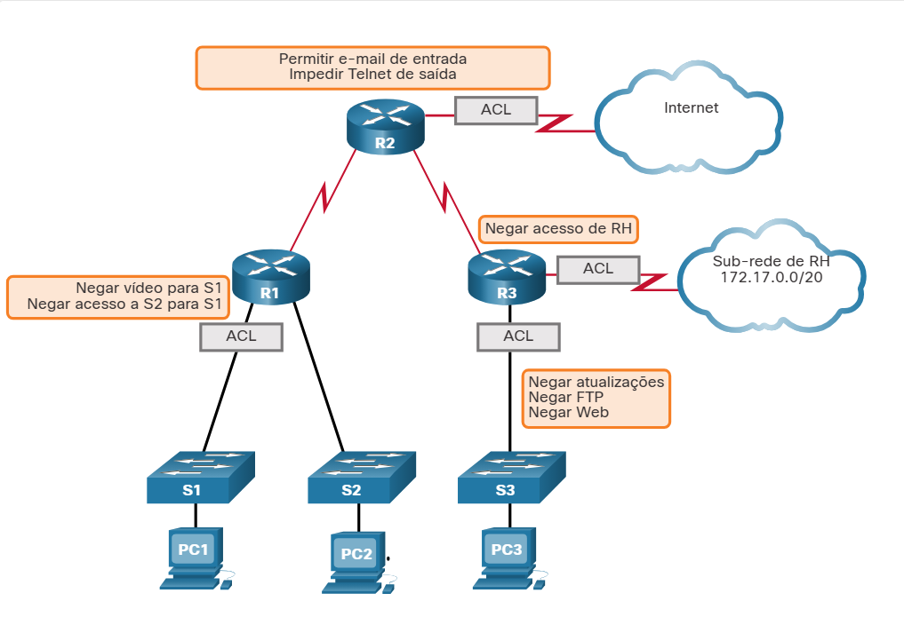
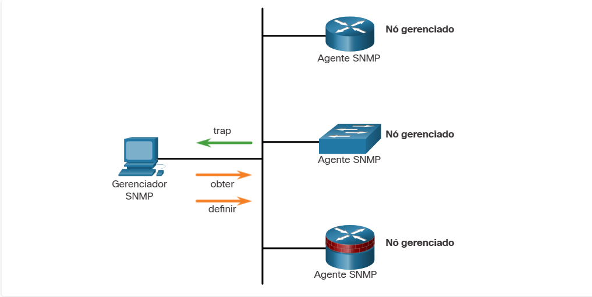
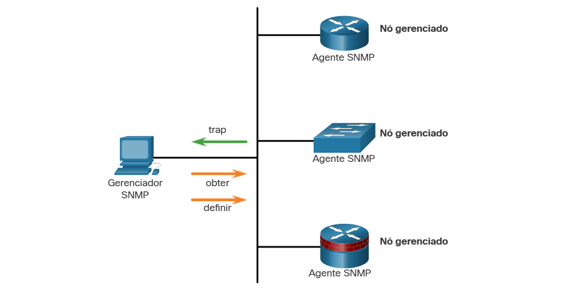
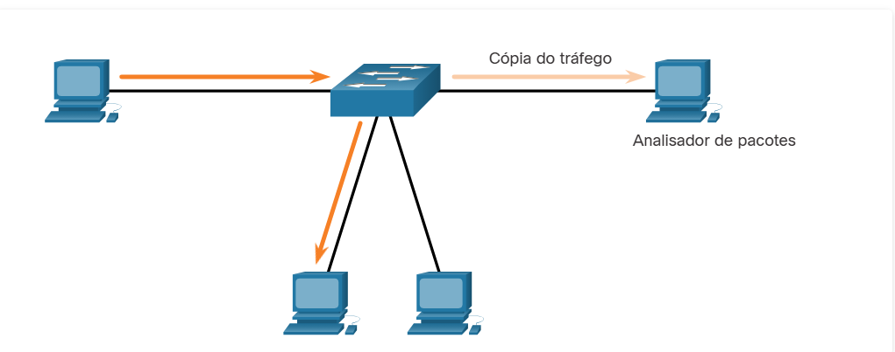
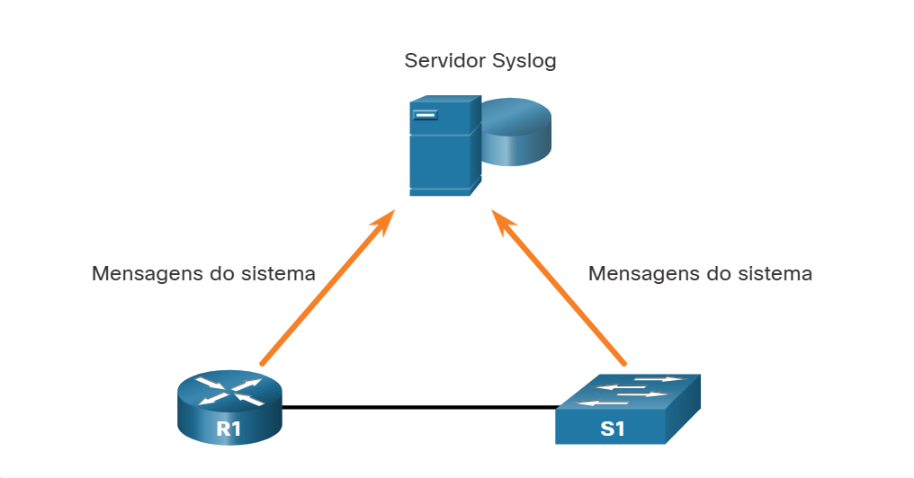
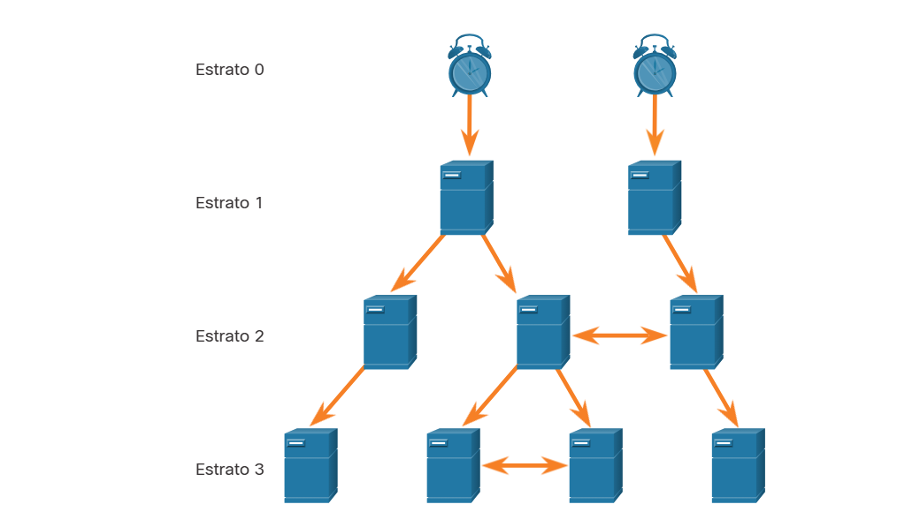
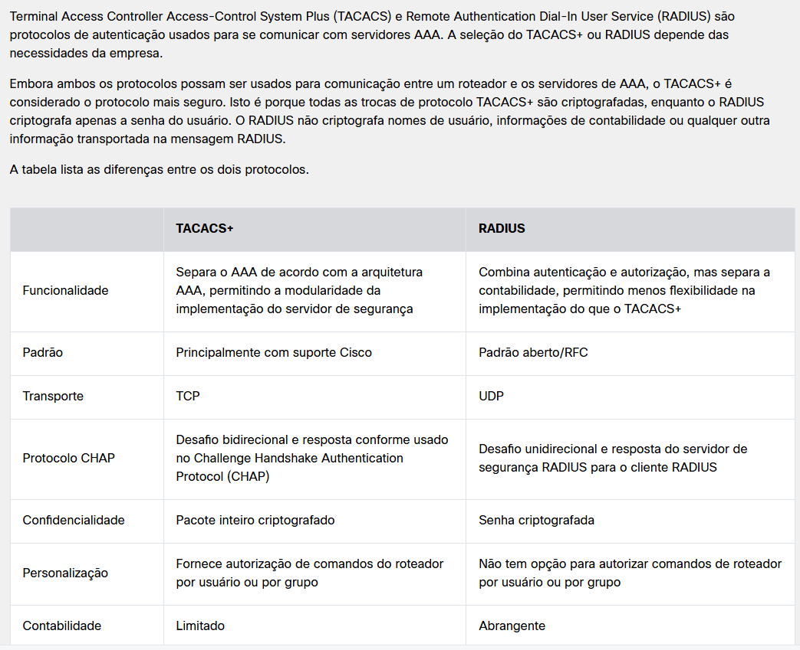
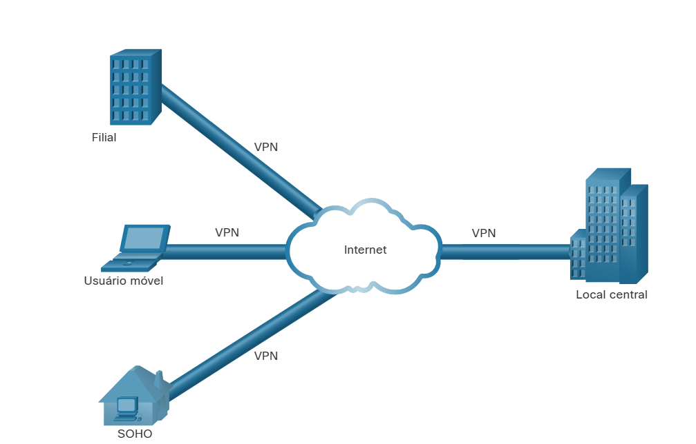

# 6.2.2 Controle de tráfego com ACLs

O que é uma ACL?
Uma lista de controle de acesso (ACL) é uma série de comandos que controlam se um dispositivo encaminha ou descarta pacotes com base nas informações encontradas no cabeçalho do pacote. Quando configuradas, as ACLs executam as seguintes tarefas:

- Eles limitam o tráfego da rede para aumentar o desempenho da rede. Por exemplo, se a política corporativa não permite tráfego de vídeo na rede, as ACLs que bloqueiam tráfego de vídeo podem ser configuradas e aplicadas. Isso reduziria significativamente a carga da rede e aumentaria o desempenho da rede.
- Eles fornecem controle de fluxo de tráfego. As ACLs podem restringir o fornecimento de atualizações de roteamento para garantir que as atualizações sejam de uma fonte conhecida.
- Elas fornecem um nível básico de segurança para acesso à rede. As ACLs podem permitir que um host acesse uma parte da rede e impedir que outro host acesse a mesma área. Por exemplo, o acesso à rede de Recursos Humanos poderá ser restrito a usuários autorizados.
- Elas filtram o tráfego com base no tipo de tráfego. Por exemplo, uma ACL pode permitir tráfego de correio eletrônico, mas bloquear todo o tráfego de Telnet.
- Elas examinam hosts para permitir ou negar acesso aos serviços de rede. As ACLs podem permitir ou negar a um usuário o acesso a tipos de arquivo, como FTP ou HTTP.

Além da permissão ou negação de tráfego, as ACLs podem ser usadas selecionando tipos de tráfego que serão analisados, enviados ou processados de outras formas. Por exemplo, as ACLs podem ser usadas para classificar o tráfego para ativar o processamento de prioridade. Esse recurso é semelhante a ter um ingresso VIP em um show ou em evento esportivo. O ingresso VIP fornece aos convidados selecionados os privilégios não oferecidos aos portadores de bilhetes de admissão geral, como a entrada prioritária ou possibilidade de entrar em uma área restrita.

A figura mostra uma topologia de amostra com ACLs aplicadas aos roteadores R1, R2 e R3.

O que é uma ACL?

# 6.2.5 SNMP

O protocolo SNMP (Protocolo Simples de Gerenciamento de Rede) permite que os administradores gerenciem dispositivos finais como servidores, estações de trabalho, roteadores, switches e dispositivos de segurança em uma rede IP. Permite que os administradores de rede monitorem o desempenho da rede, encontrem e resolvam os problemas da rede e planejem o crescimento da rede.

O SNMP é um protocolo da camada de aplicação que fornece um formato de mensagem para a comunicação entre gerenciadores e agentes.

Como mostrado na figura, o sistema SNMP consiste em dois elementos.

Gerenciador SNMP que executa o software de gerenciamento SNMP.
Agentes SNMP que são os nós que estão sendo monitorados e gerenciados.
O Management Information Base (MIB) é um banco de dados dos agentes que armazena dados e estatísticas operacionais sobre o dispositivo.

Para configurar o SNMP em um dispositivo de rede, primeiramente é necessário definir a relação entre o gerenciador e o agente.

O gerenciador de SNMP faz parte de um sistema de gerenciamento de rede (NMS). O gerenciador de SNMP executa o software de gerenciamento de SNMP. Conforme mostrado na figura, o gerente SNMP pode coletar informações de um agente SNMP usando a ação "get" e pode alterar as configurações em um agente usando a ação "set". Além disso, os agentes SNMP podem encaminhar informações diretamente para um gerenciador de rede usando “traps”.

# 6.2.6 NetFlow

NetFlow é uma tecnologia CISCO IOS que fornece estatísticas em pacotes que passam por meio de um switch multicamadas ou de um roteador da Cisco. Enquanto o SNMP tenta fornecer uma ampla gama de recursos e opções de gerenciamento de rede, o NetFlow está focado em fornecer estatísticas sobre pacotes IP que fluem através de dispositivos de rede.

O NetFlow fornece dados para permitir monitoramento de rede e segurança, planejamento de rede, análise de tráfego para incluir identificação de gargalos de rede e contabilidade IP para fins de faturamento. Por exemplo, na figura, o PC 1 se conecta ao PC 2 usando um aplicativo como HTTPS.

NetFlow na rede

O NetFlow pode monitorar essa conexão de aplicativo, rastreando contagens de bytes e pacotes para esse fluxo de aplicativo individual. Em seguida, envia as estatísticas para um servidor externo chamado coletor NetFlow.

A tecnologia NetFlow tem visto várias gerações que oferecem mais sofisticação na definição de fluxos de tráfego, mas fluxos “NetFlow original” diferenciados usando uma combinação de sete campos. Caso um desses campos varie em valor de outro pacote, os pacotes podem ser determinados com segurança como sendo de fluxos diferentes:

Endereço IP de origem
Endereço IP de destino
Número da porta de origem
Número da porta de destino
Tipo de protocolo da camada 3
Marcação de tipo de serviço (ToS)
Interface lógica de entrada
Os quatro primeiros campos que o NetFlow usa para identificar um fluxo devem ser familiares. Os endereços IP de origem e destino, além das portas de origem e destino, identificam a conexão entre o aplicativo de origem e de destino. O tipo de protocolo da Camada 3 identifica o tipo de cabeçalho que segue o cabeçalho IP (geralmente TCP ou UDP, mas outras opções incluem ICMP). O byte ToS no cabeçalho IPv4 contém informações sobre como os dispositivos devem aplicar regras de qualidade de serviço (QoS) aos pacotes nesse fluxo.

# 6.2.7 Espelhamento de portas

Farejamento de tráfego usando um switch
Um analisador de pacotes (também conhecido como sniffer de pacotes ou sniffer de tráfego) é normalmente um software que captura pacotes que entram e saem da placa de interface de rede (NIC). Nem sempre é possível ou desejável ter o analisador de pacotes no dispositivo que está sendo monitorado. Às vezes, é melhor em uma estação separada designada para capturar os pacotes.

Como os switches de rede podem isolar o tráfego, os sniffers de tráfego ou outros monitores de rede, como IDS, não podem acessar todo o tráfego em um segmento de rede. O espelhamento de portas é um recurso que permite que um switch faça cópias duplicadas do tráfego que passa por um switch e, em seguida, enviá-lo para fora uma porta com um monitor de rede conectado. O tráfego original é encaminhado da maneira usual. Um exemplo de espelhamento de porta é ilustrado na figura.

Farejamento de tráfego usando um switch

# 6.2.8 Servidores Syslog

Syslog
Quando determinados eventos ocorrem em uma rede, os dispositivos de rede têm mecanismos confiáveis para notificar o administrador com mensagens de sistema detalhadas. Essas mensagens podem não ser críticas ou podem ser significativas. Os administradores de rede têm uma variedade de opções de armazenamento, interpretação, exibição dessas mensagens e para serem alertados sobre as mensagens que podem ter maior impacto na infraestrutura de rede.

O método mais comum de acessar mensagens do sistema é usar um protocolo chamado syslog.

Muitos dispositivos de rede são compatíveis com syslog, incluindo: roteadores, switches, servidores de aplicativos, firewalls e outros dispositivos de rede. O protocolo syslog permite que os dispositivos de rede enviem suas mensagens de sistema pela rede para os servidores syslog, conforme mostrado na figura.

Syslog

# 6.2.9 NTP
Níveis de estrato NTP
É importante sincronizar a hora em todos os dispositivos da rede porque todos os aspectos de gerenciamento, proteção, solução de problemas e planejamento de redes exigem um registro de data e hora preciso e consistente. Quando a hora não está sincronizada entre os dispositivos, será impossível determinar a ordem dos eventos que ocorreram em diferentes partes da rede.

Normalmente, as configurações de data e hora em um dispositivo de rede podem ser definidas usando um destes dois métodos:

Configuração manual de data e hora
Configurando o Network Time Protocol (NTP)
Conforme a rede cresce, torna-se cada vez mais difícil garantir que todos os dispositivos da infraestrutura operem com horário sincronizado. Mesmo em um ambiente de rede menor, o método manual não é o ideal. Se um dispositivo for reinicializado, como ele obterá uma data e um carimbo de hora precisos?

A melhor solução é configurar o NTP na rede. Esse protocolo permite que os roteadores na rede sincronizem as configurações de hora com um servidor NTP. Um grupo de clientes NTP que obtém informações de data e hora de uma única fonte tem configurações de hora mais consistentes. Quando o NTP é implementado na rede, ele pode ser configurado para sincronizar com um relógio mestre privado ou pode ser sincronizado com um servidor NTP disponível publicamente na Internet.

As redes NTP usam um sistema hierárquico de fontes de horário. Cada nível desse sistema hierárquico é denominado stratum. O nível do stratum é definido como o número de contagens de saltos da fonte oficial. O horário sincronizado é distribuído através da rede usando o NTP. A figura exibe uma amostra de uma rede NTP.

Níveis de estrato NTP

Os servidores NTP são organizados em três níveis conhecidos como estratos:

Estrato 0 - Uma rede NTP obtém o tempo de fontes de tempo confiáveis. Essas fontes, também conhecidas como dispositivos de stratum 0, são dispositivos de pontualidade de alta precisão, com pouco ou nenhum atraso associado a eles.
Estrato 1 - Os dispositivos do estrato 1 estão diretamente conectados às fontes de tempo autorizadas. Eles atuam como o principal padrão de horário da rede.
Estrato 2 e estratos inferiores - Os servidores estrato 2 são conectados aos dispositivos estrato 1 por meio de conexões de rede. Os dispositivos do stratum 2, como os clientes NTP, sincronizam a hora usando os pacotes NTP dos servidores do stratum 1. Eles também podem atuar como servidores dos dispositivos do stratum 3.

Números menores de stratum indicam que o servidor está mais próximo da fonte de horário autorizada, se comparados aos números de strati maiores. Quanto maior o número do stratum, mais baixo seu nível. A valor máximo da contagem de saltos é 15. O Stratum 16, o nível mais baixo de stratum, indica que um dispositivo não está sincronizado. Servidores de horário no mesmo nível de stratum podem ser configurados para agir como pares com outros servidores de horário no mesmo nível de stratum, para finalidades de backup ou verificação da hora.

# 6.2.10 Servidores AAA

- Autenticação
Os usuários e administradores devem provar quem são.
A autenticação pode ser estabelecida usando combinações de nome de usuário e senha, perguntas e respostas de desafio, tokens e outros métodos.
A autenticação AAA fornece uma maneira centralizada de controlar o acesso à rede.

- Autorização
Após a autenticação do usuário, os serviços de autorização determinam quais recursos o usuário pode acessar e quais operações ele tem permissão para executar.
Um exemplo é “O usuário‘ aluno ’pode acessar o host serverXYZ usando apenas SSH.”

- Accounting (Contabilidade)
O accounting registra o que o usuário faz, incluindo o que é acessado, a quantidade de tempo em que o recurso é acessado e todas as alterações efetuadas.
O accounting rastreia como os recursos de rede são usados.
Um exemplo é "O usuário 'aluno' acessou o servidor host XYZ usando SSH por 15 minutos".

# 6.2.11 VPN
Rede Virtual Privada
Uma VPN é uma rede privada criada em uma rede pública, geralmente a Internet, conforme mostrado na figura.
Rede Virtual Privada

Em vez de usar uma conexão física dedicada, uma VPN usa conexões virtuais que são roteadas pela Internet da organização para o site remoto. As primeiras VPNs eram túneis IP restritos que não incluíam autenticação ou criptografia dos dados. Por exemplo, Generic Routing Encapsulation (GRE) é um protocolo de encapsulamento desenvolvido pela Cisco que pode encapsular uma ampla variedade de tipos de pacote de protocolo de camada de rede dentro de túneis IP. Isso cria um link ponto-a-ponto virtual com roteadores Cisco em pontos remotos sobre uma rede interconectada IP.

Uma VPN é virtual, pois carrega informações dentro de uma rede privada, mas essas informações são realmente transportadas por uma rede pública. Uma VPN é privada, pois o tráfego é criptografado para manter os dados confidenciais enquanto são transportados pela rede pública.

A VPN é um ambiente de comunicações no qual o acesso é controlado rigorosamente para permitir conexões de mesmo nível em uma comunidade com interesses definidos. A confidencialidade é alcançada criptografando o tráfego dentro da VPN. Hoje, uma implementação segura de VPN com criptografia é o que geralmente é equiparado ao conceito de rede virtual privada.

No sentido mais simples, uma VPN conecta dois endpoints, como um escritório remoto a um escritório central, através de uma rede pública, para formar uma conexão lógica. As conexões lógicas podem ser feitas na Camada 2 ou na Camada 3. Exemplos comuns de VPNs de Camada 3 são GRE, MPLS (Multiprotocol Label Switching) e IPsec. As VPNs de camada 3 podem ser conexões de site ponto a ponto, como GRE e IPsec, ou podem estabelecer qualquer conectividade para muitos sites usando MPLS.

O IPsec é um conjunto de protocolos desenvolvido com o apoio do IETF para obter serviços seguros em redes IP comutadas por pacotes.

Os serviços de IPsec permitem a autenticação, integridade, controle de acesso e confidencialidade. Com o IPsec, as informações trocadas entre sites remotos podem ser criptografadas e verificadas. As VPNs são normalmente implantadas em uma topologia site a site para conectar sites centrais com locais remotos com segurança. Eles também são implantados em uma topologia de acesso remoto para fornecer acesso remoto seguro a usuários externos que viajam ou trabalham de casa. As VPNs de acesso remoto e site-to-site podem ser implantadas usando IPsec.