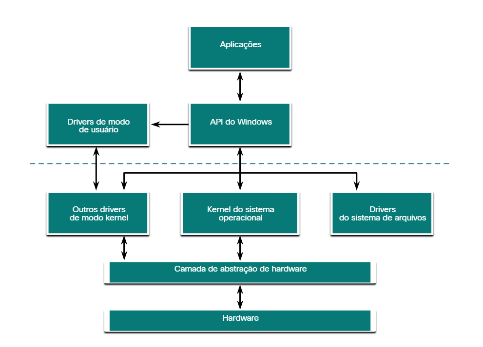
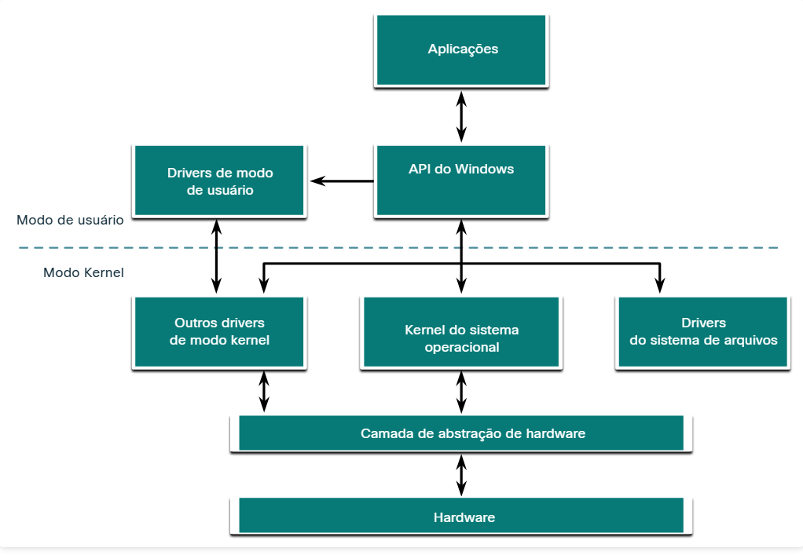
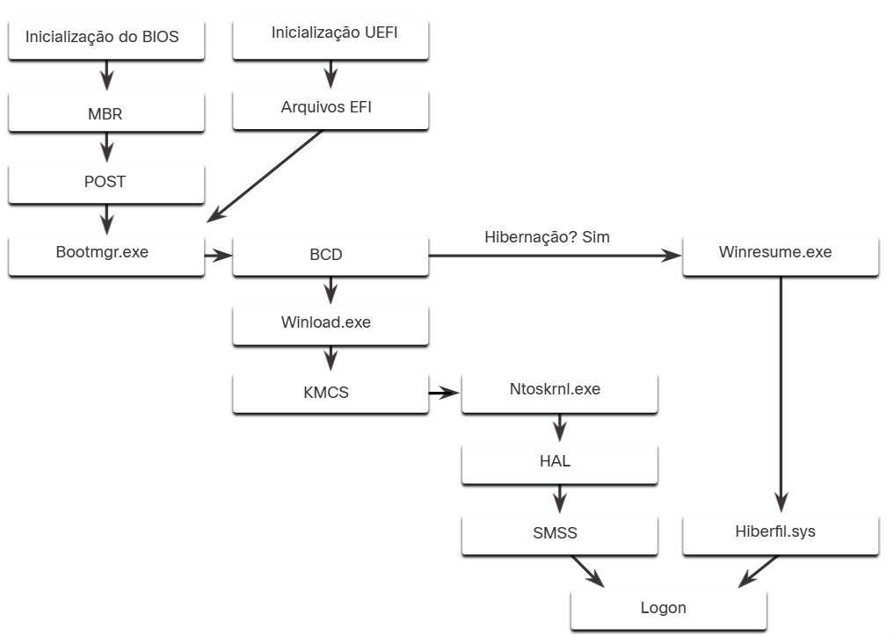

# 7.2.1 Camada de Abstração de Hardware

Computadores Windows usam muitos tipos diferentes de hardware. O sistema operacional pode ser instalado em um computador comprado ou em um computador que é montado pelo usuário. Quando o sistema operacional está instalado, ele deve ser isolado das diferenças no hardware. A arquitetura básica do Windows é mostrada na figura.

Uma camada de abstração de hardware (HAL) é um software que lida com toda a comunicação entre o hardware e o kernel. O kernel é o núcleo do sistema operacional e tem controle sobre todo o computador. Ele lida com todas as solicitações de entrada e saída, memória e todos os periféricos conectados ao computador.

Em alguns casos, o kernel ainda se comunica diretamente com o hardware, portanto não é completamente independente do HAL. O HAL também precisa do kernel para executar algumas funções.

# 7.2.2 Modo de Usuário e Modo Kernel

Conforme identificado na figura, existem dois modos diferentes em que uma CPU opera quando o computador tem o Windows instalado: o modo de usuário e o modo kernel.

Os aplicativos instalados são executados no modo de usuário e o código do sistema operacional é executado no modo kernel. O código que está sendo executado no modo kernel tem acesso irrestrito ao hardware subjacente e é capaz de executar qualquer instrução de CPU. O código do modo kernel também pode referenciar qualquer endereço de memória diretamente. Geralmente reservado para as funções mais confiáveis do sistema operacional, falhas no código em execução no modo kernel param a operação de todo o computador. Por outro lado, programas como aplicativos de usuário são executados no modo de usuário e não têm acesso direto a locais de hardware ou memória. O código do modo de usuário deve passar pelo sistema operacional para acessar recursos de hardware. Devido ao isolamento fornecido pelo modo de usuário, as falhas no modo de usuário são restritas apenas ao aplicativo e são recuperáveis. A maioria dos programas no Windows são executados no modo de usuário. Drivers de dispositivo, peças de software que permitem que o sistema operacional e um dispositivo se comuniquem, podem ser executados no modo kernel ou usuário, dependendo do driver.

Todo o código que é executado no modo kernel usa o mesmo espaço de endereço. Os drivers de modo kernel não têm isolamento do sistema operacional. Se ocorrer um erro com o driver em execução no modo kernel e ele gravar no espaço de endereço errado, o sistema operacional ou outro driver de modo kernel pode ser afetado negativamente. A este respeito, o driver pode falhar, fazendo com que todo o sistema operacional falhe.

Quando o código de modo de usuário é executado, ele é concedido seu próprio espaço de endereço restrito pelo kernel, juntamente com um processo criado especificamente para o aplicativo. A razão para essa funcionalidade é principalmente para impedir que aplicativos alterem o código do sistema operacional que está sendo executado ao mesmo tempo. Ao ter seu próprio processo, esse aplicativo tem seu próprio espaço de endereço privado, tornando outros aplicativos incapazes de modificar os dados nele. Isso também ajuda a evitar que o sistema operacional e outros aplicativos falhe se esse aplicativo falhar.

#  7.2.3 Sistemas de Arquivos do Windows

## exFAT
Este é um sistema de arquivos simples suportado por muitos sistemas operacionais diferentes.
O FAT tem limitações para o número de partições, tamanhos de partições e tamanhos de arquivo que pode resolver, portanto, não é mais usado para discos rígidos (HDs) ou unidades de estado sólido (SSDs).
Tanto o FAT16 quanto o FAT32 estão disponíveis para uso, sendo o FAT32 o mais comum porque tem muito menos restrições do que o FAT16.

## Sistema de Arquivos Hierárquico Plus (HFS+)
Este sistema de arquivos é usado em computadores MAC OS X e permite nomes de arquivos, tamanhos de arquivo e tamanhos de partição muito mais longos do que os sistemas de arquivos anteriores.
Embora não seja suportado pelo Windows sem software especial, o Windows é capaz de ler dados de partições HFS+.

## Sistema de arquivos estendido (EXT)
Este sistema de arquivos é usado com computadores baseados em Linux.
Embora não seja suportado pelo Windows, o Windows é capaz de ler dados de partições EXT com software especial.

## Novo Sistema de Tecnologia de Arquivos (NTFS)
Este é o sistema de arquivos mais comumente usado ao instalar o Windows. Todas as versões do Windows e Linux suportam NTFS.
Computadores Mac-OS X só podem ler uma partição NTFS. Eles são capazes de gravar em uma partição NTFS depois de instalar drivers especiais.

O NTFS é o sistema de arquivos mais utilizado para Windows por muitas razões. NTFS suporta arquivos e partições muito grandes e é muito compatível com outros sistemas operacionais. O NTFS também é muito confiável e oferece suporte a recursos de recuperação. Mais importante ainda, ele suporta muitos recursos de segurança. O controle de acesso a dados é alcançado através de descritores de segurança. Esses descritores de segurança contêm permissões e propriedade do arquivo até o nível do arquivo. O NTFS também controla muitos carimbos de data/hora para controlar a atividade do arquivo. Às vezes referido como MACE, os carimbos de data/hora Modificar, Access (acesso), Create (criar) e Entry Modified (entrada modificada) são frequentemente usados em investigações forenses para determinar o histórico de um arquivo ou pasta. O NTFS também suporta criptografia do sistema de arquivos para proteger toda a mídia de armazenamento.

Antes que um dispositivo de armazenamento, como um disco, possa ser usado, ele deve ser formatado com um sistema de arquivos. Por sua vez, antes que um sistema de arquivos possa ser colocado em prática em um dispositivo de armazenamento, o dispositivo precisa ser particionado. Um disco rígido é dividido em áreas denominadas partições. Cada partição é uma unidade lógica de armazenamento que pode ser formatada para armazenar informações, como arquivos de dados ou de aplicações. Durante o processo de instalação, a maioria dos sistemas operacionais particiona e formata automaticamente o espaço disponível na unidade com um sistema de arquivos como o NTFS.

A formatação NTFS cria estruturas importantes no disco para armazenamento de arquivos e tabelas para gravar os locais dos arquivos:

Setor de inicialização da partição - São os primeiros 16 setores da unidade. Ele contém o local da tabela de arquivos mestre (MFT). Os últimos 16 setores contêm uma cópia do setor de inicialização.
Master File Table (MFT) - Esta tabela contém os locais de todos os arquivos e diretórios na partição, incluindo atributos de arquivo, como informações de segurança e carimbos de data/hora.
Arquivos de sistema - São arquivos ocultos que armazenam informações sobre outros volumes e atributos de arquivo.
Área do Arquivo - A área principal da partição onde os arquivos e diretórios são armazenados.
Nota: Ao formatar uma partição, os dados anteriores ainda podem ser recuperados porque nem todos os dados são completamente removidos. O espaço livre pode ser examinado e os arquivos podem ser recuperados, o que pode comprometer a segurança. Recomenda-se executar um apagamento seguro em uma unidade que está sendo reutilizada. O apagamento seguro grava dados em toda a unidade várias vezes para garantir que não haja dados restantes.

# 7.2.4 Fluxos de Dados Alternativos

NTFS armazena arquivos como uma série de atributos, como o nome do arquivo ou um carimbo de data/hora. Os dados que o arquivo contém são armazenados no atributo $DATA, e é conhecido como um fluxo de dados. Usando NTFS, você pode conectar fluxos de dados alternativos (ADSs) ao arquivo. Às vezes, isso é usado por aplicativos que estão armazenando informações adicionais sobre o arquivo. O ADS é um fator importante ao discutir malware. Isso ocorre porque é fácil ocultar dados em um ADS. Um invasor pode armazenar código mal-intencionado dentro de um ADS que pode ser chamado de um arquivo diferente.

No sistema de arquivos NTFS, um arquivo com um ADS é identificado após o nome do arquivo e dois pontos, por exemplo, Testfile.txt:ADS. Este nome de arquivo indica que um ADS chamado ADS está associado ao arquivo chamado Testfile.txt. Um exemplo de ADS é mostrado na saída do comando.

# 7.2.5 Processo de Inicialização do Windows

Muitas ações ocorrem entre o momento em que o botão liga/desliga do computador é pressionado e o Windows está totalmente carregado, como mostrado na figura. Isso é conhecido como o processo de inicialização do Windows.

Existem dois tipos de firmware de computador:

## Basic Input-Output System (Sistema básico de Entrada-Saída - BIOS)
O firmware do BIOS foi criado no início dos anos 80 e funciona da mesma maneira que quando foi criado. À medida que os computadores evoluíram, tornou-se difícil para o firmware do BIOS suportar todos os novos recursos solicitados pelos usuários.

## Unified Extensible Firmware Interface (UEFI)
O UEFI foi projetado para substituir o BIOS e oferecer suporte aos novos recursos.

No firmware do BIOS, o processo começa com a fase de inicialização do BIOS. Isso ocorre quando os dispositivos de hardware são inicializados e um POST (Power On Self-Test) é executado para garantir que todos esses dispositivos estejam se comunicando. Quando o disco do sistema é descoberto, o POST termina. A última instrução no POST é procurar o registro mestre de inicialização (MBR).

A MBR contém um pequeno programa que é responsável por localizar e carregar o sistema operacional. O BIOS executa esse código e o sistema operacional começa a carregar.

Em contraste com o firmware do BIOS, o firmware UEFI tem muita visibilidade sobre o processo de inicialização. O UEFI inicializa carregando arquivos de programa EFI, armazenados como arquivos.efi em uma partição de disco especial, conhecida como EFI System Partition (ESP).

Nota: Um computador que usa UEFI armazena o código de inicialização no firmware. Isso ajuda a aumentar a segurança do computador no momento da inicialização porque o computador entra diretamente no modo protegido.

Independentemente de o firmware ser BIOS ou UEFI, depois que uma instalação válida do Windows for localizada, o arquivo Bootmgr.exe será executado. Bootmgr.exe alterna o sistema do modo real para o modo protegido para que toda a memória do sistema possa ser usada.

Bootmgr.exe lê o banco de dados de configuração de inicialização (BCD). O BCD contém qualquer código adicional necessário para iniciar o computador, juntamente com uma indicação de se o computador está saindo da hibernação ou se este é um arranque a frio. Se o computador estiver saindo da hibernação, o processo de inicialização continuará com o Winresume.exe. Isso permite que o computador leia o arquivo Hiberfil.sys que contém o estado do computador quando foi colocado em hibernação.

Se o computador estiver sendo inicializado a partir de uma inicialização a frio, o arquivo Winload.exe será carregado. O arquivo Winload.exe cria um registro da configuração de hardware no registro. O registro é um registro de todas as configurações, opções, hardware e software do computador. O registro será explorado em profundidade posteriormente neste capítulo.Winload.exe também usa Kernel Mode Code Signing (KMCS) para garantir que todos os drivers sejam assinados digitalmente. Isso garante que os drivers são seguros para carregar à medida que o computador é iniciado.

Depois que os drivers forem examinados, o Winload.exe executa o Ntoskrnl.exe, que inicia o kernel do Windows e configura o HAL. Finalmente, o Subsistema do Gestor de Sessões (SMSS) lê o registo para criar o ambiente do utilizador, iniciar o serviço Winlogon e preparar a área de trabalho de cada utilizador à medida que inicia sessão.

# 7.2.6 Inicialização do Windows

Há dois itens de registro importantes que são usados para iniciar automaticamente aplicativos e serviços:

HKEY_LOCAL_MACHINE - Vários aspectos da configuração do Windows são armazenados nesta chave, incluindo informações sobre serviços que iniciam com cada inicialização.
HKEY_CURRENT_USER - Vários aspectos relacionados ao usuário logado são armazenados nesta chave, incluindo informações sobre serviços que iniciam somente quando o usuário faz logon no computador.
O registro será discutido mais adiante neste tópico.

Entradas diferentes nesses locais de registro definem quais serviços e aplicativos serão iniciados, conforme indicado pelo tipo de entrada. Esses tipos incluem Run, RunOnce, RunServices, RunServicesOnce e Userinit. Essas entradas podem ser inseridas manualmente no registro, mas é muito mais seguro usar a ferramenta Msconfig.exe . Esta ferramenta é usada para exibir e alterar todas as opções de inicialização do computador. Use a caixa de pesquisa para localizar e abrir a ferramenta Msconfig.

A ferramenta Msconfig abre a janela Configuração do sistema. Existem cinco guias que contêm as opções de configuração.

## Geral
Três tipos de inicialização diferentes podem ser escolhidos aqui. Normal carrega todos os drivers e serviços. O diagnóstico carrega apenas drivers e serviços básicos. Seletivo permite que o usuário escolha o que carregar na inicialização.

## Inicialização do Sistema
Qualquer sistema operacional instalado pode ser escolhido aqui para iniciar. Existem também opções para a inicialização segura, que é usada para solucionar problemas de inicialização.

## Serviços
Todos os serviços instalados estão listados aqui para que possam ser escolhidos para iniciar na inicialização.

## Startup
Todos os aplicativos e serviços configurados para iniciar automaticamente na inicialização podem ser ativados ou desabilitados abrindo o gerenciador de tarefas a partir desta guia.

## Ferramentas
Muitas ferramentas comuns do sistema operacional podem ser iniciadas diretamente a partir desta guia.

# 7.2.8 Processos, Threads e Serviços

Um aplicativo do Windows é composto de processos. O aplicativo pode ter um ou muitos processos dedicados a ele. Um processo é qualquer programa em execução no momento. Cada processo que é executado é composto de pelo menos um thread. Um thread é uma parte do processo que pode ser executado. O processador executa cálculos na thread. Para configurar processos do Windows, procure o Gerenciador de Tarefas. A guia Processos do Gerenciador de Tarefas é mostrada na figura.

Todos os threads dedicados a um processo estão contidos no mesmo espaço de endereço. Isso significa que esses threads podem não acessar o espaço de endereço de qualquer outro processo. Isso evita a corrupção de outros processos. Como Windows é multitarefas, vários threads podem ser executados ao mesmo tempo. A quantidade de threads que podem ser executados ao mesmo tempo depende do número de processadores do computador.

Alguns dos processos executados pelo Windows são serviços. Estes são programas que são executados em segundo plano para suportar o sistema operativo e as aplicações. Eles podem ser configurados para iniciar automaticamente quando o Windows for inicializado ou podem ser iniciados manualmente. Eles também podem ser interrompidos, reiniciados ou desativados.

Os serviços fornecem funcionalidade de longa execução, como sem fio ou acesso a um servidor FTP. Para configurar os Serviços do Windows, procure serviços. O miniaplicativo do painel de controle dos Serviços do Windows é mostrado na figura.

Tenha muito cuidado ao manipular as configurações desses serviços. Alguns programas dependem de um ou mais serviços para funcionar corretamente. Encerrar um serviço pode afetar negativamente aplicativos ou outros serviços.

# 7.2.9 Alocação e alças de memória

Um computador funciona armazenando instruções na RAM até que a CPU os processe. O espaço de endereço virtual para um processo é o conjunto de endereços virtuais que o processo pode usar. O endereço virtual não é o local físico real na memória, mas uma entrada em uma tabela de página que é usada para traduzir o endereço virtual para o endereço físico.

Cada processo em um computador Windows de 32 bits suporta um espaço de endereço virtual que permite endereçar até 4 gigabytes. Cada processo num computador Windows de 64 bits suporta um espaço de endereço virtual de 8 terabytes.

Cada processo de espaço do usuário é executado em um espaço de endereço privado, separado de outros processos de espaço do usuário. Quando o processo de espaço do usuário precisa acessar recursos do kernel, ele deve usar um identificador de processo. Isso ocorre porque o processo de espaço do usuário não tem permissão para acessar diretamente esses recursos do kernel. O identificador do processo fornece o acesso necessário para o processo de espaço do usuário sem uma conexão direta com ele.

Uma ferramenta poderosa para visualizar a alocação de memória é RAMMap, que é mostrado na figura. RAMMap faz parte do conjunto de ferramentas do Windows Sysinternals. Ele pode ser baixado da Microsoft. RAMMap fornece uma riqueza de informações sobre como o Windows alocou memória do sistema para o kernel, processos, drivers e aplicativos.

# 7.2.10 O Registro do Windows

O Windows armazena todas as informações sobre hardware, aplicativos, usuários e configurações do sistema em um banco de dados grande conhecido como o Registro. As formas como esses objetos interagem também são registradas, como quais arquivos um aplicativo abre e todos os detalhes de propriedade de pastas e aplicativos. O registro é um banco de dados hierárquico onde o nível mais alto é conhecido como um ramo, abaixo que existem chaves, seguido por subchaves. Os valores armazenam dados e são armazenados nas chaves e subchaves. Uma chave do Registro pode ter até 512 níveis de profundidade.

## HKEY_CURRENT_USER (HKCU)
Contém informações sobre o usuário conectado no momento.

## HKEY_USERS (HKU)
Contém informações relativas a todas as contas de usuário no host.

## HKEY_CLASSES_ROOT (HKCR)
Contém informações sobre registros OLE (vinculação e incorporação de objetos). OLE permite que os usuários incorporem objetos de outros aplicativos (como uma planilha) em um único documento (como um documento do Word).

## HKEY_LOCAL_MACHINE (HKLM)
Contém informações relacionadas ao sistema.

## HKEY_CURRENT_CONFIG (HKCC)
Contém informações sobre o perfil de hardware atual.

Novas seções (hives) não podem ser criadas. As chaves do Registro e os valores nas seções podem ser criados, modificados ou excluídos por uma conta com privilégios administrativos. Como mostrado na figura, a ferramenta regedit.exe usada para modificar o registro. Tenha muito cuidado ao usar esta ferramenta. Alterações menores no registro podem ter efeitos maciços ou mesmo catastróficos.

A navegação no registro é muito semelhante ao explorador de arquivos do Windows. Use o painel esquerdo para navegar nas seções (hives) e na estrutura abaixo dele e use o painel direito para ver o conteúdo do item realçado no painel esquerdo. Com tantas chaves e subchaves, o caminho da chave pode se tornar muito longo. O caminho é exibido na parte inferior da janela para referência. Como cada chave e subchave é essencialmente um contêiner, o caminho é representado muito parecido com uma pasta em um sistema de arquivos. A barra invertida (∖) é usada para diferenciar a hierarquia do banco de dados.

As chaves do Registro podem conter uma subchave ou um valor. Os diferentes valores que as chaves podem conter são os seguintes:

REG_BINARY - Números ou valores booleanos
REG_DWORD - Números maiores que 32 bits ou dados brutos
REG_SZ - Valores de string
Como o registro contém quase toda infomação do sistema operacional e do usuário, é essencial garantir que ele não seja comprometido. Aplicativos potencialmente mal-intencionados podem adicionar chaves do Registro para que elas sejam iniciadas quando o computador for iniciado. Durante uma inicialização normal, o usuário não verá o programa iniciar porque a entrada está no registro e o aplicativo não exibe janelas ou indicação de início quando o computador for inicializado. Um keylogger, por exemplo, seria devastador para a segurança de um computador se ele fosse iniciado na inicialização sem o conhecimento ou consentimento do usuário. Ao executar auditorias de segurança normais ou corrigir um sistema infectado, revise os locais de inicialização do aplicativo no registro para garantir que cada item seja conhecido e seguro para ser executado.

O registro também contém a atividade que um usuário executa durante o uso diário normal do computador. Isso inclui o histórico de dispositivos de hardware, incluindo todos os dispositivos que foram conectados ao computador, incluindo o nome, o fabricante e o número de série. Outras informações, como quais documentos um usuário e um programa abriram, onde eles estão localizados e quando foram acessados, são armazenadas no registro. Isso tudo é uma informação muito útil quando uma investigação forense precisa ser realizada.

