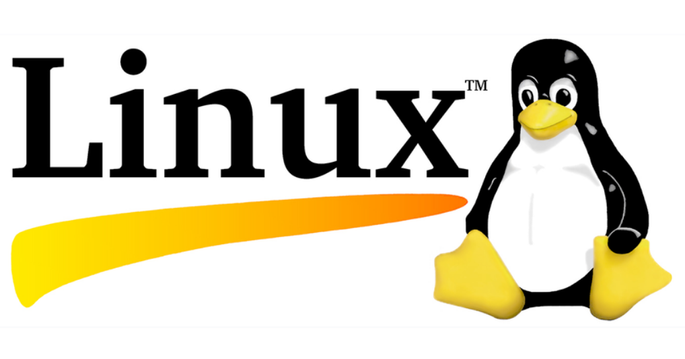

# 8.1.1 O que é Linux?

Linux é um sistema operacional criado em 1991. O Linux é de código aberto, rápido, confiável e pequeno. Ele requer muito poucos recursos de hardware para ser executado e é altamente personalizável. Ao contrário de outros sistemas operacionais, como Windows e Mac OS X, Linux foi criado, e atualmente é mantido por, uma comunidade de programadores. Linux faz parte de várias plataformas e pode ser encontrado em dispositivos de qualquer lugar, desde “relógios de pulso a supercomputadores”.

Outro aspecto importante do Linux é que ele foi projetado para ser conectado à rede, o que torna muito mais simples escrever e usar aplicativos baseados em rede. Como o Linux é open source, qualquer pessoa ou empresa pode obter o código-fonte do kernel, inspecioná-lo, modificá-lo e recompilá-lo à vontade. Eles também estão autorizados a redistribuir o programa com ou sem encargos.

Uma distribuição Linux é o termo usado para descrever pacotes criados por diferentes organizações. Distribuições Linux (ou distros) incluem o kernel Linux com ferramentas personalizadas e pacotes de software. Embora algumas dessas organizações possam cobrar por seu suporte de distribuição Linux (voltado para empresas baseadas em Linux), a maioria delas também oferece sua distribuição gratuitamente sem suporte. Debian, Red Hat, Ubuntu, CentOS e SUSE são apenas alguns exemplos de distribuições Linux.

# 8.1.2 O valor do Linux

O Linux é frequentemente o sistema operacional escolhido no Centro de Operações de Segurança (SOC). Estas são algumas das razões para escolher o Linux:

Linux é open source - Qualquer pessoa pode adquirir Linux gratuitamente e modificá-lo para atender a necessidades específicas. Essa flexibilidade permite que analistas e administradores criem um sistema operacional especificamente para análise de segurança.
A CLI do Linux é muito poderosa - Embora uma GUI torne muitas tarefas mais fáceis de executar, ela adiciona complexidade e requer mais recursos de computador para executar. A CLI (Interface da Linha de comando) Linux é extremamente poderosa e permite que os analistas executem tarefas não apenas diretamente em um terminal, mas também remotamente.
O usuário tem mais controle sobre o sistema operacional - O usuário administrador no Linux, conhecido como o usuário root, ou superusuário, tem poder absoluto sobre o computador. Ao contrário de outros sistemas operacionais, o usuário raiz pode modificar qualquer aspecto do computador com algumas teclas pressionadas. Essa capacidade é especialmente valiosa quando se trabalha com funções de baixo nível, como a pilha de rede. Ele permite que o usuário raiz tenha controle preciso sobre a maneira como os pacotes de rede são manipulados pelo sistema operacional.
Ele permite um melhor controle de comunicação de rede - Controle é uma parte inerente do Linux. Como o sistema operacional pode ser ajustado em praticamente todos os aspectos, é uma ótima plataforma para a criação de aplicativos de rede. Esta é a mesma razão pela qual muitas grandes ferramentas de software baseadas em rede estão disponíveis apenas para Linux.

# 8.1.3 Linux no SOC

A flexibilidade fornecida pelo Linux é um ótimo recurso para o SOC. Todo o sistema operacional pode ser adaptado para se tornar a plataforma de análise de segurança perfeita. Por exemplo, os administradores podem adicionar apenas os pacotes necessários ao sistema operacional, tornando-o simples e eficiente. Ferramentas de software específicas podem ser instaladas e configuradas para funcionar em conjunto, permitindo que os administradores criem um computador personalizado que se encaixe perfeitamente no fluxo de trabalho de um SOC.

A figura mostra o Sguil, que é o console do analista de segurança cibernética em uma versão especial do Linux chamada Security Onion. O Security Onion é um conjunto de ferramentas de código aberto que trabalham juntas para análise de segurança de rede.

